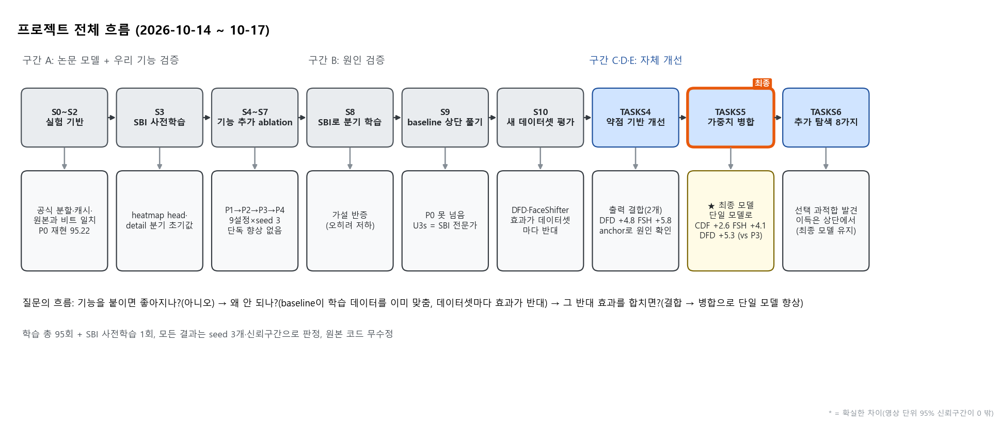
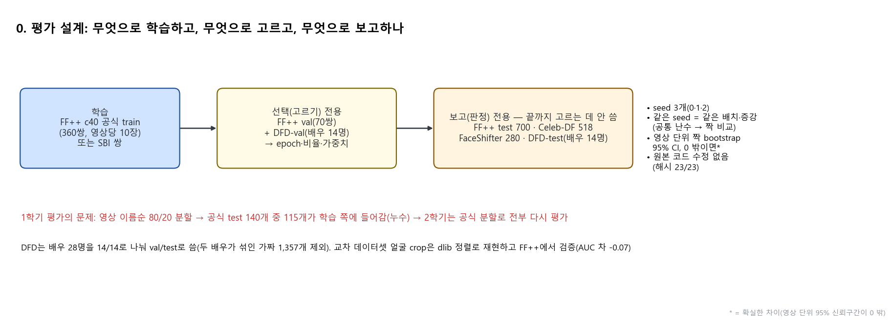
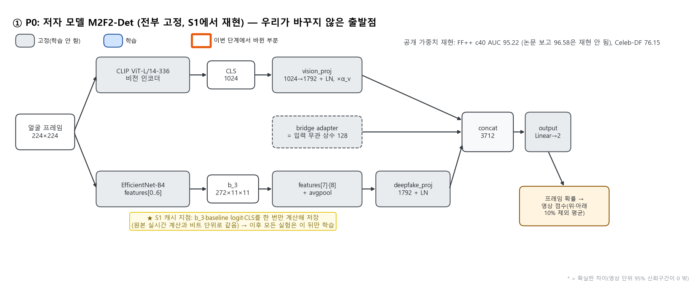
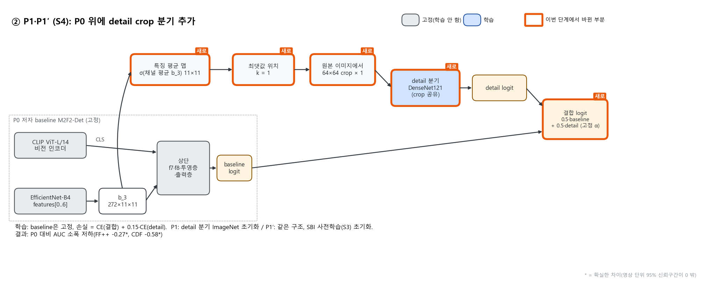
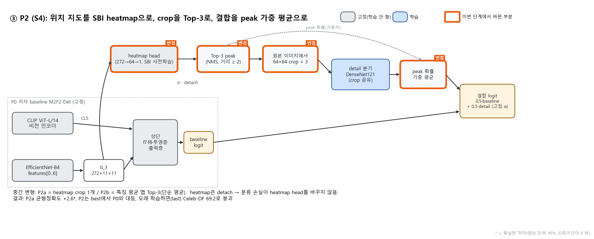
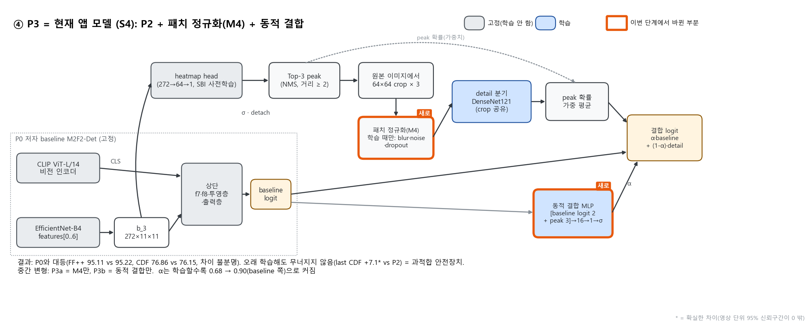
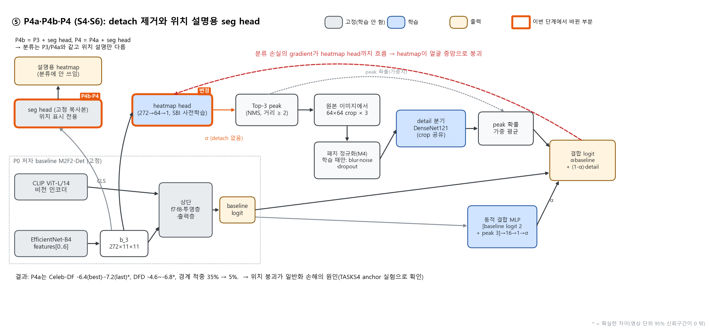
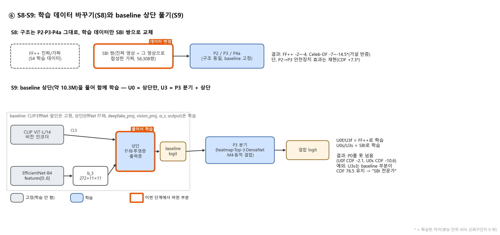
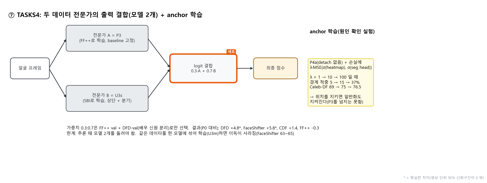
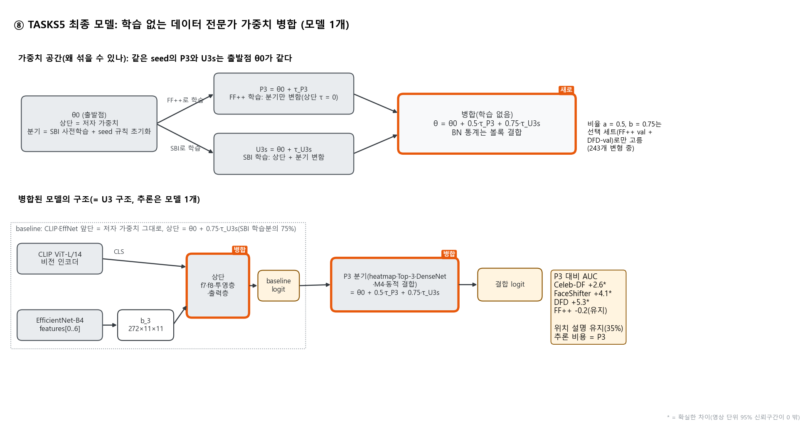

# DeepSight 통제 비교 실험 — 처음부터 최종 모델까지

작성 2026-10-18. 대상 독자: 이 프로젝트를 처음 보는 팀원·지도교수님.
이 폴더(`PROJECT_FLOW`)는 흩어져 있던 실험 기록을 **읽는 순서대로** 모은 것이다. 문서는 원본(`C:\m2f2\exp\`)의 복사본이고, 원본이 바뀌면 `python code/make_project_flow.py`로 다시 만든다. 파이프라인 그림은 `python code/flow_figs.py`로 만든다.

---

## 0. 먼저 읽을 것

### 0.1 최종 결론 (세 줄)
1. 논문 모델(M2F2-Det, P0) 위에 우리가 붙인 기능(세부 crop 분기, heatmap, 동적 결합 등)은 **단독으로는 성능을 확실히 올리지 못했다.** 대신 원인과 평가 함정을 밝혔다.
2. 원인에서 출발해 **FF++ 전문가와 SBI 전문가의 가중치를 학습 없이 병합한 단일 모델**을 만들었다. 이것이 **최종 모델**이다.
3. 최종 모델은 논문 모델 대비 학습에 쓰지 않은 데이터셋 3곳에서 AUC가 확실히 올랐다.
   - Celeb-DF **+2.7**, FaceShifter **+4.9**, DFD **+4.9**(95% 신뢰구간 0 밖, 오류 11~17% 감소)
   - 학습 데이터(FF++) 성능은 유지됐고, 추론 비용은 같다.
   - 정확도(ACC)는 오르지 않았다. 가짜 비율이 높은 세트 때문이며, 균형 정확도로는 DFD +5.9다(§4).

### 0.2 이 폴더를 읽는 순서
| 순서 | 위치 | 무엇 |
|---|---|---|
| 1 | **이 문서** | 전체 흐름, 단계별 구조 그림·설정·결과·해석 |
| 2 | `figs/` | 이 문서에 들어간 파이프라인 그림 10장 |
| 3 | `01_설계와_규칙/` | 실험 설계 원본(HANDOFF), 규칙 상세(PROTOCOL) |
| 4 | `02_기능추가실험_S0-S7/` | 기능 추가 실험 종합 보고서(S7_report, S8~S10까지 이어서 정리됨) |
| 5 | `03_후속검증_S8-S10/` | 후속 실험 자동 생성 표 |
| 6 | `04_개선1차_TASKS4/` | 약점 기반 개선 1차(출력 결합, anchor 등) |
| 7 | `05_최종모델_TASKS5/` | **최종 모델(가중치 병합)** 보고서와 AUC 외 가치 |
| 8 | `06_추가탐색_TASKS6/` | 추가 향상 탐색 8가지와 교훈 |
| 9 | `07_논문_발표/` | 논문 초안(최종 = v2), 발표 개요, 발표 표현, 가치 평가 |
| 10 | `08_진행기록_참고/` | 진행 로그·결정 기록(PROGRESS), 파일 지도(GUIDE), 전체 학습 기록(registry.csv) |

자세한 파일별 "볼 부분"은 §5에 있다.

### 0.3 그림 읽는 법
- **회색** 상자: 고정(학습 안 함). **파란색**: 학습. **노란색**: 출력.
- **주황 굵은 테두리 + 태그**: 그 단계에서 새로 생기거나 바뀐 부분.
- **빨간 점선**: gradient가 흐르는 경로.
- `*`: 확실한 차이(영상 단위 95% 신뢰구간이 0 밖). 문서 본문에서는 ✔로 표시한다.

---

## 1. 전체 흐름

**질문의 흐름**
1. 논문 모델에 우리 기능을 붙이면 좋아지나? → 단독으로는 아니다(S4~S7).
2. 왜 안 되나? → 고정된 논문 모델이 학습 데이터를 이미 거의 완벽히 맞춘다. 데이터를 바꾸거나 모델을 풀어도 마찬가지다(S8·S9). 그리고 효과가 데이터셋마다 반대로 나온다(S10).
3. 그 "반대 효과"를 합치면? → 두 전문가의 출력 결합(TASKS4) → 가중치 병합으로 단일 모델(TASKS5, **최종**)
4. 더 올릴 수 있나? → 8가지를 더 시도했다. 손해 없는 추가 향상 1건은 사후 규칙으로 골라서 보조 결과로 두었다. 대신 "검증 세트 과적합"이라는 교훈을 얻었다(TASKS6).

| 단계 | 날짜 | 질문 | 바꾼 것 | 핵심 결과 | 정리 파일(이 폴더) |
|---|---|---|---|---|---|
| S0~S2 | 10-14~15 | 실험을 공정하게 할 수 있나 | 공식 분할, 출력 캐시, 옵션형 모델 | P0 재현 95.22, 캐시 = 원본(비트 일치), 5.7배 가속 | 02/01_S7_report §1·§7 |
| S3 | 10-15 | 분기 초기값 | SBI 사전학습 | seg head 경계 적중 35% | 02/01_S7_report §5 |
| S4 | 10-15 | 기능별 효과 | P1→P2→P3→P4a | 단독 향상 없음, detach 제거 −6.4 ✔ | 02/01_S7_report §2·§3 |
| S5 | 10-15 | 데이터 양별 | 25·50% | P4a는 데이터가 적을수록 나쁨 | 02/01_S7_report §4.1 |
| S6 | 10-15 | 위치 설명이 맞나 | 마스크 정렬·위치 지표 | P3 경계 적중 35.6% vs 중앙 0% | 02/01_S7_report §5 |
| S7 | 10-16 | 왜 안 되나 | 분석 | baseline이 학습 데이터를 이미 맞춤 | 02/01_S7_report §6·§8·§9 |
| S8 | 10-16 | 데이터를 바꾸면 | 학습 데이터 → SBI | 가설 반증(오히려 저하) | 02/01_S7_report §10 |
| S9 | 10-17 | 모델을 풀면 | baseline 상단 학습 | P0 못 넘음, U3s = SBI 전문가 | 02/01_S7_report §11 |
| S10 | 10-17 | 다른 데이터셋에서는 | DFD·FaceShifter 평가 | 효과가 데이터셋마다 반대 | 02/01_S7_report §12, 03/04 |
| TASKS4 | 10-17 | 약점으로 개선 | 출력 결합, anchor 등 7종 | DFD +4.8·FaceShifter +5.8 ✔(모델 2개) | 04/03_t4_improvements |
| TASKS5 | 10-17 | 단일 모델로 | **가중치 병합** | **최종 모델**: P3 대비 CDF +2.6·FSH +4.1·DFD +5.3 ✔ | 05/02_t5_final |
| TASKS6 | 10-17 | 더 올리기 | 8가지 | 검증 세트 과적합 발견, 최종 모델 유지 | 06/02_t6_final |

---

## 2. 모든 실험에 공통인 설정

### 2.1 고정한 것 (모든 설정에서 같음)
- **모델**: 저자 공개 가중치 M2F2-Det(`current_model_180.pth`)를 eval 모드로 고정했다. 원본 코드(`C:\m2f2\code`, `M2F2_Det`, `weights`)는 한 번도 수정하지 않았다(해시 23/23 일치).
- **데이터**: FF++ c40 공식 분할(train 360 / val 70 / test 70쌍)을 썼다.
  - 학습: 영상당 10장, 진짜:가짜 1:1 균형 스케줄(가짜 4묶음을 epoch마다 순환)
  - 검증: 8장
  - 테스트: 첫 100장
- **학습**: AdamW lr 5e-5, wd 1e-3, cosine, 배치 16, fp16 AMP, gradient clip 1.0, 20 epoch. 손실은 CE(결합) + 0.15·CE(detail)이다.
- **seed**: 0·1·2. 같은 seed면 모든 설정이 **같은 배치 순서·같은 증강**을 보고(공통 난수), 같은 모듈은 같은 초기값에서 출발한다. 그래서 설정끼리 "짝 비교"가 된다.
- **모델 선택**: 클래스 균형 val 손실이 최저인 epoch(best)와 마지막 epoch(last)를 둘 다 보고한다. 테스트로는 고르지 않는다.

### 2.2 평가와 판정
- **영상 점수**: 프레임 확률에서 위·아래 10%(FF++ test는 10장)를 뺀 평균(저자 방식)이다. 저자 평가 코드의 라벨 귀속 버그는 수정했다(AUC 95.11 → 95.22).
- **지표**: 영상 AUC(주 지표), 기준값 0.5의 ACC·균형 정확도(bACC)·오탐률·미탐률, heatmap 위치 지표(S6)
- **판정**
  - S4~S9: seed 3개가 모두 같은 방향이고 차이가 seed 표준편차의 2배 이상이면 "향상/저하"로 본다.
  - S10 이후: 영상 단위 짝 bootstrap 95% 신뢰구간이 0 밖이면 ✔로 본다.
- **세트 역할(TASKS4부터)**
  - 선택 세트: FF++ val + DFD-val. 비율·가중치를 고를 때만 쓴다.
  - 보고 세트: FF++ test, Celeb-DF, FaceShifter, DFD-test. 끝까지 고르는 데 쓰지 않는다.
  - DFD는 배우 28명을 14/14로 나눴다.

### 2.3 실험 속도 설계 (S1)
- 고정된 논문 모델의 중간 출력(b_3 = EfficientNet 중간 특징 272×11×11, baseline logit, CLIP CLS)을 **한 번만 계산해 저장**하고, 그 뒤에 붙는 부분만 학습했다.
- 저장값은 원본 실시간 계산과 **비트 단위로 같다**는 것을 확인했다. 원본 방식보다 약 **5.7배 빠르다**(18분 vs 105분, S2).
- 그래서 학습 실행 95회(각 20epoch) + SBI 사전학습 1회(10epoch)를 며칠 안에 할 수 있었다.

---

## 3. 단계별 상세

### 3.1 S0~S2 — 실험 기반과 논문 모델(P0) 재현

- **목적**: 이후 모든 실험(P1~P4a 등 95회)을 ① 공정한 데이터 분할로, ② 빠르게, ③ P0(논문 모델)와 같은 조건으로 돌릴 수 있는 기반을 만든다. 1학기 평가는 영상 이름순 80/20 분할이라 공식 test 140개 중 115개가 학습 쪽에 들어가 있었다(누수).
- **구조(P0)**: P0는 논문 구조를 새로 구현·학습한 것이 아니라, **저자 공개 코드와 가중치를 그대로 불러와 평가만 한 것**이다(학습 없음).
  - 두 갈래의 결과를 이어 붙인다: CLIP ViT-L/14 → CLS → vision_proj, EfficientNet-B4 앞단 → b_3 → features[7]·[8] → deepfake_proj.
  - 여기에 bridge adapter를 더해 출력층으로 보낸다. 구현을 확인해 보니 **bridge adapter는 마지막 LayerNorm(1) 때문에 입력과 무관한 상수를 낸다**(예측에 기여 안 함).
- **방법**: 아래 4가지를 순서대로 했다.
  1. **공식 분할 인덱스(S0~S1)**
     - FF++ 저자가 제공한 공식 분할(train 360 / val 70 / test 70쌍)을 쓴다.
     - 인덱스 = "어느 영상의 몇 번째 프레임을 쓸지"를 정한 목록이다. 학습은 영상당 10장·검증은 8장을 균등 간격(`i = floor((j+0.5)·n/k)`)으로 뽑고, 테스트는 첫 100프레임이다.
     - 목록을 파일(`cache/index/`)과 해시로 저장해 모든 실험이 같은 프레임을 보게 한다.
  2. **출력 캐시(S1)**
     - 논문 모델 부분은 고정이라 같은 프레임이면 출력이 항상 같다. 그 출력(b_3, baseline logit, CLIP CLS)을 **한 번만 계산해 디스크에 저장**하고, 이후 실험은 저장값을 읽는다.
     - **26분**은 이 캐시를 처음 만드는 데 걸린 시간이다(test 70,000 · val 5,600 · Celeb-DF 16,420 · train 36,000 + 좌우반전 36,000프레임). 한 번만 드는 비용이다.
     - 이 캐시로 P0를 다시 평가해 **원본 평가와 같은 값이 나오는지** 확인했다(게이트: 영상 AUC 차이 ±0.3 이내 → 실제 95.219 vs 95.217).
  3. **옵션형 모델 ExpModel(S2)**
     - 원본 `improved_model.py`는 최종 형태(P3) 하나만 구현되어 있어 "기능을 하나씩 뺀 P1·P2" 같은 중간 설정을 만들 수 없다.
     - ExpModel은 한 클래스에 스위치를 단 모델이다(crop 분기, 위치 지도 종류, crop 개수, 패치 정규화, 동적 결합, detach 등). P1~P4a는 같은 코드에서 스위치만 다르다. 그래서 성능 차이를 "코드가 달라서"가 아니라 "그 기능 때문"이라고 말할 수 있다. 입력은 원본 이미지가 아니라 캐시된 값이다.
  4. **S2 검증 5가지**: 새로 만든 코드가 원본과 같은지 확인한다.
     - ① P3 설정의 출력이 원본 `improved_model`과 같은 입력에서 같은가(eval·train 모두 비트 동일)
     - ② 반복문으로 자르던 crop을 벡터화한 버전이 같은 crop을 내는가(121개 위치, 무작위 입력에서 동일)
     - ③ detach 제거가 실제로 작동하는가(P3의 heatmap에는 gradient가 없고 P4a에는 있다. 크기 0.034)
     - ④ 같은 seed로 두 번 돌리면 같은 결과가 나오는가(파라미터 742개까지 비트 동일)
     - ⑤ 캐시 방식과 원본 방식으로 P3를 각각 1회 학습해 결과 차이를 본다(원본 104.7분 vs 캐시 18.3분. FF++ AUC +0.17·Celeb-DF −0.78로 seed 변동 범위 안. 원인은 색 변형을 crop에만 건 것과 난수 흐름)
- **결과**: P0 FF++ c40 AUC **95.22**(논문 보고 96.58은 공개 가중치로 재현 안 됨), Celeb-DF 76.15(논문 Table 4의 74.82와 비슷)
- **해석: 왜 직접 잰 95.22를 기준으로 하는가**
  - 기준선 후보가 세 개였다: 논문 보고 96.58 / 저자 평가 코드로 잰 95.11(라벨 귀속 버그 포함) / 버그를 고친 우리 평가 95.22.
  - 논문 수치는 공개 가중치로 재현되지 않고 원인도 확인하지 못했다. 논문 수치를 기준으로 삼으면 "기능의 효과"와 "평가 방식 차이"를 구분할 수 없다.
  - 그래서 P1 이후 모든 설정을 **같은 데이터·같은 평가 방식으로 잰 95.22**와 비교한다. 위 기반(캐시·ExpModel)이 P0와 같은 값을 재현하므로 이 비교가 공정하다.
- **정리 파일**: `02_기능추가실험_S0-S7/01_S7_report.md` §1·§7, `01_설계와_규칙/01_HANDOFF.md` §4

### 3.2 S3 — SBI 사전학습 (분기의 초기값)
- **목적**: heatmap head와 detail 분기에 "합성 경계를 찾는 능력"을 미리 학습시킨다.
- **학습 데이터**: FF++의 가짜 영상은 쓰지 않았다. FF++ 공식 train **진짜** 영상 523개(랜드마크가 있는 프레임 14,077장)로 SBI 합성 쌍을 직접 만들어 썼다.
  - SBI(Self-Blended Images): 진짜 얼굴 한 장을 변형해 자기 자신에게 섞은 가짜다. 섞은 가장자리에 흔적이 남는다.
  - 변형 4가지를 적용해 56,308쌍(진짜, SBI 가짜)을 만들었다. 공식 val 진짜 88영상에서 만든 880쌍은 체크포인트 선택에만 썼다.
- **정답(GT)**
  - heatmap: SBI를 만들 때 섞은 영역(블렌드 마스크 M, 81점 랜드마크 볼록껍질을 변형한 것)을 알고 있다. 이 마스크의 **테두리**를 정답으로 쓴다. 경계값 B = 4·M·(1−M)을 11×11로 줄인 뒤 원본 `generate_heatmap_gt`로 만든다(진짜 이미지는 전부 0).
  - detail: 정답 peak 위치에서 자른 64×64 crop이다. SBI 가짜 crop과 같은 위치의 진짜 crop을 구분하게 한다.
- **손실·학습**: 총 손실 = focal loss(heatmap) + 1.0 × CE(detail). AdamW lr 1e-4, cosine, 10 epoch, seed 0. SBI val의 손실 최저 epoch를 쓴다(결과는 10 epoch).
  - detail의 입력 crop은 **정답 위치**에서 자르므로, 두 손실은 서로의 학습에 영향을 주지 않는다. 한 반복문에서 합산해 돌리는 것일 뿐이다.
- **결과 (평가가 두 종류이므로 구분해서 읽는다)**
  - ① **SBI val(합성 데이터)**: detail crop 정확도 82.7%, heatmap 최댓값의 진짜/가짜 AUC 84.0, top-1 peak가 정답 영역에 적중한 비율 20.9%(무작위 초기 4.0%, 얼굴 중앙 0%).
  - ② **FF++ 실제 조작 마스크(S6, 학습에 쓰지 않은 실제 가짜)**: top-1 peak 칸이 조작 영역의 **테두리**에 걸친 프레임이 35.3%다. 얼굴 중앙 고정 더미는 0%다.
    - 더미가 0%인 이유: FF++의 조작 영역이 얼굴 crop 가운데 42~54%를 덮어서, 가운데 칸은 항상 영역 안쪽이고 테두리가 아니다. 반대로 "영역 안쪽을 찍었는가"를 보는 지표에서는 더미가 99.3%로 1위가 된다. 그래서 위치 설명은 경계 지표로 평가한다.
    - 35%는 높은 수치라고 단정하기 어렵다. 경계 AUROC 70.8(무작위 47.7)처럼 무작위·더미보다 확실히 낫다는 의미이고, 프레임의 약 1/3에서만 경계 칸을 최댓값으로 짚는다. 방식별로 FS 49.9 · F2F 32.1 · NT 31.2 · DF 27.6%다. 무작위 선택 시의 경계 적중 확률은 계산하지 않았다.
- **한계**
  - **정답의 출처가 다르다.** 학습 정답은 합성이 정한 마스크의 테두리이고, 평가 정답은 실제 딥페이크가 바꾼 영역(FF++ 위조 마스크)의 테두리다. 모양이 방식마다 다르다(DF 마스크는 사각형에 가까워 SBI 볼록껍질과 가장 다르고, 경계 적중도 가장 낮다). 35%는 "합성 경계만 배운 heatmap이 실제 위조의 경계도 어느 정도 짚는다"는 뜻이며, 낮은 이유가 모양 차이 때문인지 c40 압축 등 다른 요인인지는 분리하지 않았다.
  - **S3와 S4 이후의 crop 위치가 다르다.** S3 사전학습의 detail은 **정답 위치**에서 자른 crop으로 학습했다. 반면 S4 이후의 진짜/가짜 판정 학습(P1~P4a 등)과 평가에서는 heatmap이 **예측한 위치**에서 자른다(예측은 경계 적중 35%, top-1 crop 적중 56%). S4의 판정 학습에서 detail 분기를 예측 위치 crop으로 다시 학습하므로 불일치는 S3 초기값에만 해당하고, S4의 학습과 평가 사이에는 없다. 이 불일치가 detail 단독 성능이 낮은 이유(Celeb-DF AUC 54~63)에 영향을 줬을 가능성은 낮아 보이지만 따로 검증하지 않았다.
  - 1학기 SBI head는 경계 적중이 40.3%로 더 높았다. 그러나 같은 SBI val에서 AUC 50.2(찍기 수준)여서 우리 입력 규약과 맞지 않다고 보고 새로 학습했다.
- **정리 파일**: `01_S7_report.md` §5, `01_설계와_규칙/02_PROTOCOL.md` §4.8. SBI 샘플 그림은 얼굴 이미지라 약관상 이 폴더에 넣지 않았다.

### 3.3 S4 — 기능을 한 단계씩 추가 (핵심 ablation)

모든 설정에서 baseline(논문 모델)은 고정이고, 추가한 분기만 학습한다. 9설정 × seed 3 = 27회다.

**① P1·P1′: detail crop 분기 추가**

- 바뀐 것: 특징 평균 맵(σ(b_3 채널 평균))의 최댓값 위치에서 원본 이미지 64×64를 잘라 DenseNet121로 판정한다. baseline과 고정 α = 0.5로 섞는다.
- P1은 ImageNet 초기화, P1′는 SBI 사전학습 초기화다.

**② P2a·P2b·P2: 위치 지도와 crop 개수**

- 바뀐 것
  - 위치 지도를 **SBI heatmap head**로 바꿨다(detach: 분류 손실이 heatmap을 바꾸지 않음).
  - crop을 **Top-3**(NMS)로 늘렸다.
  - 결합을 **peak 확률 가중 평균**으로 바꿨다.
- 중간 변형: P2a = heatmap crop 1개, P2b = 특징 평균 맵 Top-3

**③ P3 (= 현재 앱 모델): 패치 정규화 + 동적 결합**

- 바뀐 것
  - crop에 학습 때만 blur·noise·dropout을 건다(Method 4).
  - 고정 α 대신 **동적 결합 MLP**를 쓴다. 입력은 baseline logit과 peak 확률이고, 출력은 α다.
- 중간 변형: P3a = M4만, P3b = 동적 결합만

**④ P4a·P4b·P4: detach 제거와 위치 설명용 seg head**

- P4a: P3에서 detach만 제거했다. 분류 손실의 gradient가 heatmap head까지 흐른다.
- P4b·P4: 위치 표시 전용 고정 seg head 복사본을 붙였다. 분류는 P3·P4a와 같다.

**결과** (seed 3개 평균, best/last 체크포인트)

| 설정 | FF++ AUC best | FF++ AUC last | Celeb-DF AUC best | Celeb-DF AUC last |
|---|---|---|---|---|
| P0 | 95.22 | 95.22 | 76.15 | 76.15 |
| P1 | 94.95 | 94.35 | 75.57 | 73.41 |
| P2a | 95.03 | 94.94 | 76.73 | 72.82 |
| P2 | 95.13 | 94.30 | 76.28 | **69.15** |
| P3 | 95.11 | **95.29** | **76.86** | 76.24 |
| P4a | 94.32 | 94.36 | **70.44** | **69.07** |

| 짝 비교 | 판정 |
|---|---|
| P0 → P1 (detail 분기 추가) | **저하**(FF++ −0.27 ✔, CDF −0.58 ✔) |
| P1′ → P2a (heatmap 위치) | 균형 정확도 **+2.6 ✔** |
| P2 → P3 (M4 + 동적 결합) | **오래 학습해도 무너지지 않음**(last FF++ +1.0 ✔, CDF **+7.1 ✔**) |
| P3 → P4a (detach 제거) | **저하**(CDF −6.4 ✔ best, −7.2 ✔ last) |
| P0 → P3 (현재 vs 논문) | **차이 불분명**(FF++ −0.11, CDF +0.71) |

- **해석**
  - 어떤 기능도 논문 모델을 확실히 넘지 못했다.
  - 기능의 차이는 "오래 학습했을 때 무너지느냐(last)"와 "다른 데이터셋에서 버티느냐(CDF)"에서 갈린다.
  - 동적 결합은 학습할수록 α를 0.68 → 0.90(baseline 쪽)으로 키워, 과적합한 분기의 몫을 줄이는 **안전장치**로 작동한다.
- **정리 파일**: `01_S7_report.md` §2·§3, `02_s7_tables.md`, 그림 `s7_fig_ablation.png`·`s7_fig_curves_100.png`

### 3.4 S5 — 데이터 양별 (25·50·100%)

| 설정 | FF++ AUC best 25 / 50 / 100% | Celeb-DF AUC best 25 / 50 / 100% |
|---|---|---|
| P1 | 94.83 / 94.89 / 94.95 | 75.88 / 76.07 / 75.57 |
| P2 | 95.05 / 94.94 / 95.13 | 76.20 / 76.36 / 76.28 |
| P3 | 94.64 / 94.95 / 95.11 | 75.05 / 76.87 / 76.86 |
| P4a | **93.01** / 93.82 / 94.32 | **70.95** / 73.61 / 70.44 |

- 해석: detach를 뺀 P4a는 데이터가 적을수록 더 나쁘다. 나머지는 데이터 양에 둔감하다. 같은 데이터로는 분기가 새로 배울 것이 적다는 신호다.
- 정리 파일: `01_S7_report.md` §4.1, `s7_fig_datasize.png`

### 3.5 S6 — 위치 평가 (heatmap이 실제 조작 위치를 가리키나)
- **방법**: FF++ 조작 마스크를 h5 얼굴 crop에 정렬했다(SIFT + RANSAC, 품질 NCC ≥ 0.95, test 5,472프레임). 그다음 11×11 heatmap의 위치 지표를 쟀다.
- **주의**: 조작 영역이 얼굴 가운데 42~54%를 덮는다. 그래서 "얼굴 중앙 찍기"만으로 안쪽 지표(최댓값 적중 99%)가 1위가 된다. 그래서 **경계 지표**(경계 적중, 경계 셀 AUROC)로 판단한다.

| heatmap | 경계 적중 | 경계 셀 AUROC |
|---|---|---|
| 얼굴 중앙 고정 지도 | 0% | 47.7(무작위) |
| SBI seg head | 35.3% | 70.8 |
| **P3 분류 heatmap** | **35.6%** | 70.5 |
| P4a(detach 제거) | **4.8%** | 56.1 |

- **해석**: P3의 heatmap은 조작 경계를 무작위보다 확실히 잘 찾는다. 이 능력은 SBI 사전학습에서 오고 detach가 지킨다. detach를 빼면 heatmap이 얼굴 중앙으로 붕괴한다.
- **정리 파일**: `01_S7_report.md` §5, `05_최종모델_TASKS5/06_t5_beyond_auc.md` §1

### 3.6 S7 — 왜 성능이 안 오르나 (원인 분석)
- 고정된 논문 모델이 FF++ 학습 데이터를 이미 거의 완벽히 맞춘다. 학습 정확도는 1 epoch부터 97~98%다. 그래서 같은 데이터로 학습한 분기는 학습 데이터 특유의 패턴만 배운다. detail 분기 단독 Celeb-DF AUC는 54~63이다.
- 결합 출력은 baseline과 상관이 0.96~0.98로, 사실상 baseline이다.
- 평가 함정도 정량화했다(→ §4.3).
- 정리 파일: `01_S7_report.md` §6·§8·§9

### 3.7 S8·S9 — 데이터를 바꾸거나 모델을 풀면?

- **S8**: 구조는 그대로 두고, 학습 데이터를 baseline이 보지 않은 SBI 쌍으로 바꿨다.
  - 결과: FF++ −2~−4, Celeb-DF −7~−14.5로 **가설이 반증**됐다.
  - 단, P2 → P3 안전장치 효과는 SBI에서도 재현됐다(CDF +7.3 ✔).
- **S9**: baseline 상단(EfficientNet f7·f8 + 투영층 + 출력층, 약 10.3M)을 풀어 함께 학습했다.
  - U0 = 상단만, U3 = P3 분기 + 상단이다. FF++ 학습(f)과 SBI 학습(s)을 각각 했다.
  - 결과: **P0를 못 넘었다**(U0f CDF −2.1, U0s FF++ −4.4·CDF −10.6).
  - 예외: **U3s**(SBI + 분기)는 baseline 부분이 Celeb-DF 76.5를 지켰다(혼자 학습하면 65.6). 분기가 SBI 특화 학습을 흡수해 baseline을 보호한다. 이 모델이 뒤에서 "SBI 전문가"가 된다.
- 정리 파일: `01_S7_report.md` §10·§11, `03_후속검증_S8-S10/01_s8_tables.md`·`02_s9_tables.md`

### 3.8 S10 — 새 교차 데이터셋 (DFD·FaceShifter)
- **방법**: DFD 3,362영상과 FaceShifter 280영상(학습에 없던 위조 방식)을 추가로 평가했다.
  - 얼굴 crop은 dlib 랜드마크 정렬로 재현했다. FF++ test에서 검증한 결과 P0 AUC가 우리 crop 94.90, h5 crop 94.97로 차이는 −0.07이었다.
  - 모든 체크포인트(97개)를 평가하고 영상 단위 bootstrap CI를 계산했다.
- **결과(✔)**
  - detach 제거: Celeb-DF −5.7~−7.1, DFD −4.6~−6.8로 일관되게 해롭다.
  - SBI 미세조정 baseline(U0s): DFD +4.2, Celeb-DF −10.6
  - 고정 α 분기(P2 last): FaceShifter +6.8, Celeb-DF −7.0
  - P3: 어디서도 P0보다 나쁘지 않고 FaceShifter +0.8
- **해석**: 같은 모델의 효과가 데이터셋마다 반대다. Celeb-DF 하나로 일반화를 판단하면 반대 결론에 이를 수 있다. 동시에 **"FF++ 학습과 SBI 학습은 서로 다른 데이터셋에서 강하다"**는 개선의 단서가 됐다.
- **정리 파일**: `01_S7_report.md` §12, `03_후속검증_S8-S10/03_s10_tables.md`·`04_s10_bootstrap.md`

### 3.9 TASKS4 — 약점 기반 개선 1차

- **설정 변화**: 이때부터 선택 세트(FF++ val + DFD-val)와 보고 세트를 분리했다(§2.2).
- **시도 7종과 결과(P0 대비)**

| 방법 | 결과 | 판정 |
|---|---|---|
| **두 전문가 출력 결합**(P3 × 0.3 + U3s × 0.7, 모델 2개) | DFD **+4.8 ✔**, FaceShifter **+5.8 ✔**, CDF +1.4, FF++ −0.3 | 향상 |
| 결합 방식 비교(logit·순위·z점수) | 셋 다 비슷(순위 평균 FSH +6.0 ✔·DFD +4.5 ✔) | 향상(같은 수준) |
| anchor 학습(P4a + heatmap을 seg head에 붙잡는 MSE) | 강도 λ 1 → 10 → 100에서 경계 적중 5 → 15 → 37%, CDF 69 → 75 → 76.5 | 원인 확인(P3 초과 없음) |
| 혼합 학습(FF++ + SBI를 한 모델에) | FaceShifter 63~65(P0보다 낮음) | 이득 사라짐 |
| AdaBN, 경계 증거 결합, 라벨 없는 기준값 | 선택 세트에서 이득 없음 | 효과 없음 |

- **해석**
  - 두 학습 데이터의 상보성은 **따로 학습한 뒤 합칠 때만** 나타난다.
  - anchor 실험으로 "detach 제거의 손해 = heatmap 위치 붕괴"를 인과적으로 확인했다.
- **정리 파일**: `04_개선1차_TASKS4/03_t4_improvements.md`(종합), `04_t4_ensemble.md`, `05_t4_fusion.md`, `02_t3_best_combo.md`

### 3.10 TASKS5 — 최종 모델: 학습 없는 전문가 가중치 병합

- **아이디어**: 같은 seed의 P3(FF++ 전문가)와 U3s(SBI 전문가)는 출발점 θ0가 같다. 그래서 출력이 아니라 **가중치 자체를 섞어** 모델 하나로 만들 수 있다.
- **식**: θ = θ0 + 0.5·(θ_P3 − θ0) + 0.75·(θ_U3s − θ0)
  - BatchNorm 통계는 볼록 결합으로 섞는다.
  - 비율은 243개 변형 중 선택 세트로만 골랐다.
  - 상단 = θ0 + 0.75·τ_U3s, 분기 = θ0 + 0.5·τ_P3 + 0.75·τ_U3s다.
- **결과(P3 대비, seed 3개 평균)**

| | FF++ test | Celeb-DF | FaceShifter | DFD-test |
|---|---|---|---|---|
| P3 | 95.29 | 76.24 | 68.82 | 70.40 |
| **최종 병합 모델** | 95.13 (−0.16) | **78.84 (+2.60 ✔)** | **72.94 (+4.12 ✔)** | **75.65 (+5.25 ✔)** |

- **왜 되는가(대조 실험)**
  - FF++ 전문가를 빼고 SBI 학습량만 줄이면(WiSE-FT형) Celeb-DF −4.7 ✔ → FF++ 전문가의 지식이 기여한다.
  - 한 모델에 섞어 학습하면 FaceShifter −8.6 ✔다.
  - 학습이 필요한 증류보다 낫다(FaceShifter +2.4 ✔).
  - 모델 2개 출력 결합과 같거나 낫다(Celeb-DF +1.6 ✔).
- **함께 시도해서 효과가 작았던 것**: 기준값 보정은 P3에 적용하면 역효과였다. 좌우 반전 TTA는 +0~0.5로 불분명했다.
- **AUC 외 가치**
  - 위치 설명 유지(경계 적중 35%)
  - 진짜 영상 오탐 크게 감소(FF++ 25.7 → 14.0%, DFD 54.6 → 19.9%)
  - 추론 비용 동일
- **정리 파일**: `05_최종모델_TASKS5/02_t5_final.md`(종합), `03_t5_final_tables.md`(전체 CI), `04_t5_merge.md`, `06_t5_beyond_auc.md`

### 3.11 TASKS6 — 추가 향상 탐색 8가지

| 방법 | 최종 모델 대비 | 판정 |
|---|---|---|
| P3에서 출발해 SBI로 더 학습한 전문가(Xp3) + 병합 | FaceShifter **+1.9 ✔**, 나머지 동등 | 손해 없는 향상, 단 사후 규칙으로 선택 → **보조 결과** |
| 낮은 학습률 SBI 전문가 + 병합(선택 점수 1위) | FF++ −2.4 ✔, **Celeb-DF −5.4 ✔** | **검증 세트 과적합** |
| 하이브리드 병합(선택 2위) | Celeb-DF −4.7 ✔ | 검증 세트 과적합 |
| TIES 병합 | FSH·DFD ↑ ✔, FF++ ↓ ✔ | 맞바꿈 |
| 모듈별 비율, DARE, 전문가 추가, EMA, 집계 방식 | 동등하거나 낮음 | 효과 없음 |
| (분해) 상단만 병합 | P3 대비 4세트 모두 손해 없음(CDF +3.8 ✔) | 이득은 주로 baseline 상단에서 옴(분석용) |

- **해석**: 선택 세트의 절반이 DFD-val이다. 그래서 후보를 많이 탐색할수록 DFD에 맞춘 모델이 뽑혔다.
  - 선택 점수와 보고 세트 AUC의 순위 상관: DFD +0.90, Celeb-DF −0.19, FF++ −0.54
  - "검증 데이터로 골랐다"만으로는 충분하지 않다는 교훈이다(평가 함정 ⑦).
- **결정**: 최종 모델은 사전 규칙으로 고른 TASKS5 병합을 유지했다(팀 결정).
- **정리 파일**: `06_추가탐색_TASKS6/02_t6_final.md`

---

## 4. 최종 결론

### 4.1 최종 모델과 성능
- **최종 모델**: TASKS5 가중치 병합 단일 모델(θ0 + 0.5·τ_P3 + 0.75·τ_U3s). 학습 없이 만들고, 추론 비용은 현재 앱 모델(P3)과 같다.

**논문 모델(P0) 대비** (최종 모델은 선택 세트로 고른 기준값, P0는 0.5)

| 데이터셋 | AUC | ACC | 균형 정확도(bACC) |
|---|---|---|---|
| Celeb-DF (처음 봄) | 76.15 → **78.84 (+2.7 ✔)** | 53.1 → 52.1 (차이 없음) | 62.5 → 62.7 (차이 없음) |
| FaceShifter (처음 보는 위조 방식) | 68.01 → **72.94 (+4.9 ✔)** | 65.7 → 65.0 (차이 없음) | 동일 |
| DFD (처음 봄) | 70.78 → **75.65 (+4.9 ✔)** | 75.4 → 64.5 (−10.9 ✔) | 63.0 → **68.9 (+5.9 ✔)** |
| FF++ (학습 데이터) | 95.22 → 95.13 (유지) | 91.0 → 88.2 (−2.8 ✔) | 84.2 → 86.1 (차이 없음) |

- **오른 것**: 처음 보는 데이터셋 3곳의 AUC(오류 11~17% 감소)
- **유지된 것**: 학습 데이터 AUC, 위치 설명 능력
- **오르지 않은 것**: ACC
  - FF++·DFD는 가짜가 80~85%라 가짜로 많이 판정할수록 ACC가 높게 나온다. P0의 DFD ACC 75.4%도 "전부 가짜"(85.1%)보다 낮다.
  - 그래서 불균형 세트는 bACC로 판단한다(DFD +5.9 ✔).

### 4.2 효과가 있었던 것과 없었던 것
| 구분 | 내용 |
|---|---|
| **확실히 효과 있음** | 전문가 가중치 병합(최종), 두 전문가 출력 결합, detach 유지(제거하면 −5~7), 동적 결합 + 패치 정규화(과적합 안전장치) |
| **원인 규명** | baseline이 학습 데이터를 이미 맞춤(S7), 위치 붕괴가 일반화 손해의 원인(anchor), 병합 이득은 baseline 상단에서 옴(TASKS6) |
| **효과 없음** | detail 분기 단독, SBI로 분기 학습, baseline 상단 풀기, 혼합 학습, AdaBN, 경계 증거, 라벨 없는 기준값, P3 기준값 보정, TTA, 증류(병합보다 약함), TIES·DARE·EMA·전문가 추가·집계 방식 |

### 4.3 평가 함정 7가지 (논문 기여)
1. 분할 누수: 1학기 분할에서 공식 test 140개 중 115개가 학습에 포함됐다.
2. 테스트로 고른 기준값: 정확도 91.3%가 오탐률 27%를 가린다.
3. 저자 평가 코드의 라벨 귀속 버그: AUC −0.11
4. 위치 지표의 중앙 편향: 중앙만 찍어도 최댓값 적중 99%
5. 단일 교차 데이터셋: 같은 모델의 효과가 데이터셋마다 반대다.
6. 불균형 세트의 정확도: "전부 가짜"만으로도 ACC 85%
7. 검증 세트 과적합: 검증 점수 1위 모델이 Celeb-DF에서 −5.4

---

## 5. 파일을 읽는 순서 (이 폴더 기준)

### 5.1 빠른 길 (약 30분)
1. 이 문서 §0·§1·§4
2. `05_최종모델_TASKS5/02_t5_final.md` §0(최종 모델 결론)
3. `07_논문_발표/02_최종발표_개요.md`(발표 흐름)

### 5.2 전체 이해 (순서대로)
| 순서 | 파일 | 볼 부분 |
|---|---|---|
| 1 | `01_설계와_규칙/01_HANDOFF.md` | §0 한 문단 요약, §4 이전 세션에서 밝힌 사실, §5.2 설정 정의 P0~P4 |
| 2 | `01_설계와_규칙/02_PROTOCOL.md` | §1~12 규칙(필요할 때 참고). 후속 설계는 §14~19 |
| 3 | `02_기능추가실험_S0-S7/01_S7_report.md` | §0 결론 → §2·§3 단계별 결과 → §4 과적합 → §5 위치 → §6 원인 → §8 평가 함정 → §10~12 S8·S9·S10 |
| 4 | `02_기능추가실험_S0-S7/02_s7_tables.md` | 숫자가 더 필요할 때(방식별 AUC 등) |
| 5 | `03_후속검증_S8-S10/` 01~04 | S8·S9·S10 자동 표, `04_s10_bootstrap.md`(신뢰구간) |
| 6 | `04_개선1차_TASKS4/01_TASKS4.md` | 무엇을 왜 시도했는지(계획·로그) |
| 7 | `04_개선1차_TASKS4/03_t4_improvements.md` | 개선 7종 종합(가장 중요) → 상세는 02·04·05·06 |
| 8 | `05_최종모델_TASKS5/02_t5_final.md` | **최종 모델 종합**(방법·결과·대조·정확도·논문 가치·한계) |
| 9 | `05_최종모델_TASKS5/03_t5_final_tables.md` | 모든 후보의 전체 신뢰구간 |
| 10 | `05_최종모델_TASKS5/04_t5_merge.md`, `05_t5_calib.md` | 병합 격자, 기준값 보정 |
| 11 | `05_최종모델_TASKS5/06_t5_beyond_auc.md` | AUC 외 가치(위치·과적합·재현성·오탐) |
| 12 | `06_추가탐색_TASKS6/02_t6_final.md` | 추가 탐색 8가지와 검증 세트 과적합 |
| 13 | `07_논문_발표/01_draft_v2_논문초안_최종.md` | 논문 초안(최종 모델 기준) |
| 14 | `07_논문_발표/02_최종발표_개요.md` → `03_발표_수치와_표현.md` | 발표 흐름 → 쓸 수치·정당한 표현·금지 표현·예상 질문 |
| 15 | `07_논문_발표/04_가치평가.md` | "성능 향상이 크지 않은 결과"의 가치 판단 |
| 16 | `08_진행기록_참고/01_PROGRESS.md` | 결정·변경 기록(설계를 바꾼 이유), 날짜별 실행 로그 |
| 17 | `08_진행기록_참고/02_GUIDE.md` | 원본 폴더 전체 파일 지도(코드·결과 위치) |
| 18 | `08_진행기록_참고/03_registry.csv` | 학습 95회의 설정·지표 원자료 |

---

## 6. 참고
- **원본 위치**: 이 폴더의 문서는 `C:\m2f2\exp\`의 복사본이다. 원본 대응은 `code/make_project_flow.py`의 `PLAN`에 있다. 코드는 `exp/code/`, 실행별 결과는 `exp/runs/`, 점수 원자료는 `exp/cache/scorebank*.npz`에 있다.
- **다시 만들기**: `python code/make_project_flow.py`(문서 복사), `python code/flow_figs.py`(파이프라인 그림)
- **데이터 약관**: FaceForensics++ 계열(FF++, DFD, FaceShifter) 얼굴 이미지는 비상업 연구용이고 공개 게시가 금지되어 있다(Rössler et al., ICCV 2019). 그래서 얼굴 이미지가 든 그림은 이 폴더에 넣지 않았다. 이 폴더의 그림은 모두 도표다.
- **용어**: P0 = 논문 모델, P3 = 현재 앱 모델, SBI = 진짜 영상으로 합성한 가짜, U3s = baseline 상단까지 SBI로 학습한 모델(SBI 전문가), τ = 학습으로 바뀐 가중치(task vector), bACC = (진짜 정답률 + 가짜 정답률)/2, ✔ = 95% 신뢰구간 0 밖
