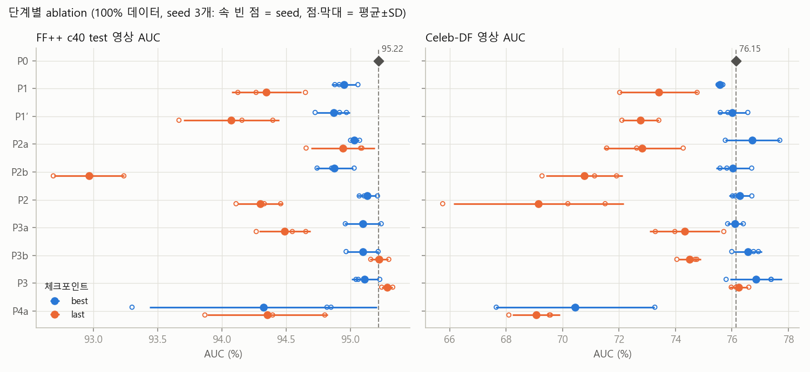
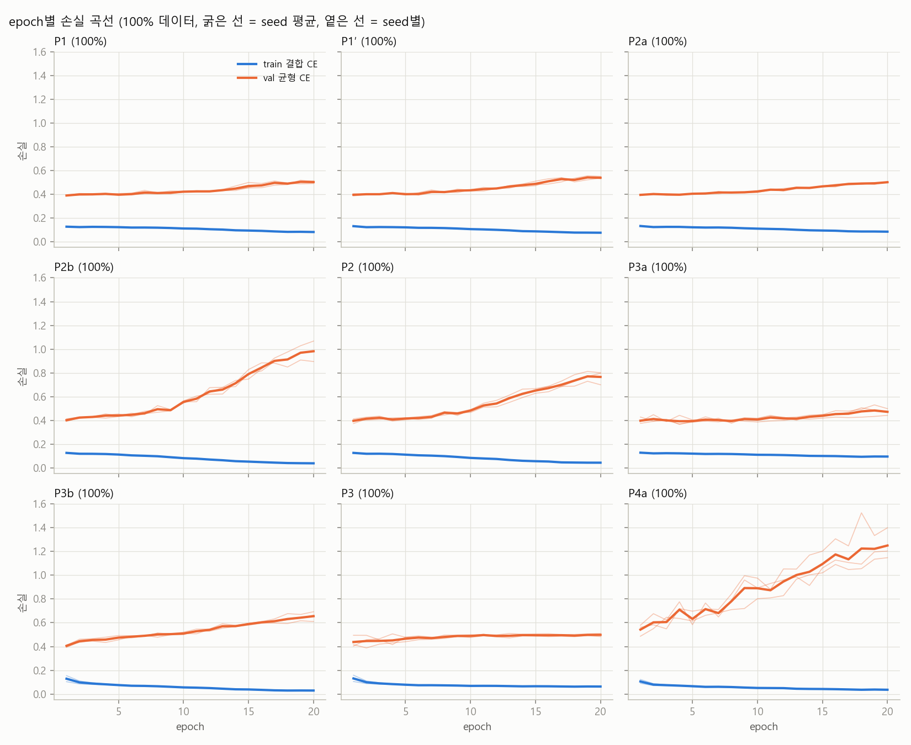
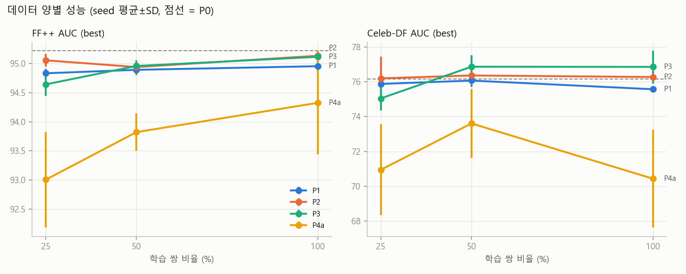
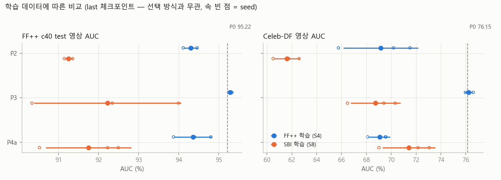
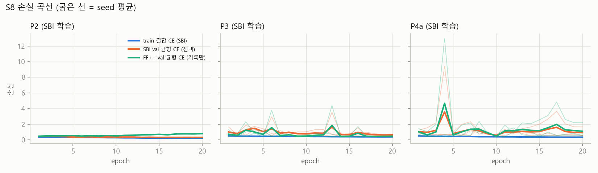
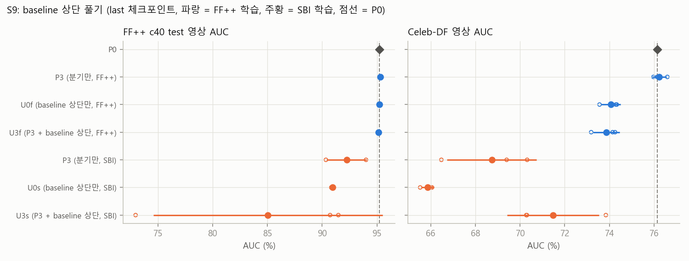
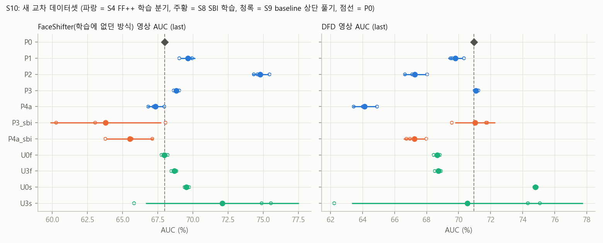

# DeepSight 통제 비교 실험 — 분석 보고서 (S7 + S8~S10)

작성 2026-10-15, S8 절 추가 2026-10-16, S9·S10 절 추가 2026-10-17. 근거 자료는 모두 이 폴더(`exp/reports/`)와 `exp/registry.csv`·`exp/runs/`에 있다. 자동 생성 전체 표는 S7 `s7_tables.md`, S8 `s8_tables.md`, S9 `s9_tables.md`, S10 `s10_tables.md`·`s10_bootstrap.md`, 실행 규칙은 `../PROTOCOL.md`(§14 S8, §15 S9, §16 S10), 진행 기록은 `../PROGRESS.md`.

---

## 0. 결론 요약

1. **고정한 저자 모델(P0) 위에 얹은 기능 중 AUC를 확실히 올린 것은 없다.** 현재 모델(P3)은 P0와 차이가 불분명하다. FF++ c40 영상 AUC 95.11±0.10 vs 95.22, Celeb-DF 76.86±0.92 vs 76.15(best 체크포인트, seed 3개).
2. **detach 제거(P4a)는 확실히 해롭다.** Celeb-DF AUC는 −6.4(best)·−7.2(last)로 seed 3개 모두 저하했다. heatmap은 조작 경계를 버리고 얼굴 중앙으로 쏠린다(경계 적중 35% → 5%).
3. 기능별 실제 역할은 이렇다.
   - heatmap 위치 crop: 균형 정확도 +2.6(P1′→P2a)
   - 패치 정규화 + 동적 결합: 후반 과적합 붕괴를 막는다(last 기준 FF++ +1.0, Celeb-DF +7.1, P2→P3)
   - detail 분기만 추가(P0→P1): AUC 소폭 저하
4. **원인: 고정 baseline이 학습 데이터를 이미 맞춘다.**
   - 1 epoch부터 학습 정확도가 97~98%다.
   - 그래서 detail 분기는 학습 데이터 특유의 패턴만 배운다. val detail 손실은 찍기 수준(ln 2)이고, Celeb-DF 단독 AUC는 54~63이다.
   - 결합 출력은 baseline과 상관이 best 기준 0.96~0.98로, 사실상 baseline이다.
   - 동적 α는 진짜/가짜를 가리지 않는 전역 가중치로 수렴한다(0.68 → 0.90).
5. **위치 설명은 SBI로 학습한 heatmap(seg head)이 맡을 수 있다.** 조작 경계를 35% 적중한다(얼굴 중앙 기준선 0%). seg head를 분리하면(P4) detach를 제거해도 이 설명이 유지된다.
6. **평가 함정 4가지를 수치로 확인했다.**
   - 1학기 분할 누수: 공식 test 140영상 중 115개가 학습 쪽에 있었다.
   - 테스트에서 고른 기준값 정확도가 오탐률 27%를 가린다.
   - 저자 평가 코드의 라벨 귀속 버그: AUC −0.11
   - 위치 지표의 중앙 편향: 중앙만 찍어도 최댓값 적중 99%
7. **논문 수치 대조.**
   - 공개 가중치의 FF++ c40 AUC는 95.22로, 논문의 96.58과 다르다.
   - Celeb-DF 76.15는 논문 Table 4(c40 학습) 74.82와 맞는다.
   - 논문 Table 3의 95.10은 SBI로 학습한 다른 변형("w/SBI")의 수치라 비교 대상이 아니다.
8. **(S8, 후속) "분기를 baseline이 안 본 데이터로 학습하면 나아질 것"이라는 가설은 반증됐다.** P2·P3·P4a를 SBI 쌍만으로 다시 학습하면 FF++·Celeb-DF AUC가 전부 확실히 떨어진다(P0 대비 FF++ −2~−4, Celeb-DF −7~−14.5, last 기준, seed 3개 모두). detail 분기가 SBI 패턴에 특화되면서 baseline 예측을 오염시킨다(결합-baseline 상관 0.97 → 0.72~0.89). 다만 **동적 결합 + 패치 정규화(P2→P3)는 SBI 학습 안에서도 일관되게 향상**(FF++ +2.1, Celeb-DF +7.3, 2SD 기준 충족) — 이 장치가 "분기가 나쁠 때 피해를 줄이는 안전장치"라는 S7 해석을 다른 데이터에서도 재확인했다. detach 제거는 SBI 학습에서도 heatmap을 얼굴 중앙으로 무너뜨리지만(경계 적중 35% → 8%), 학습이 불안정해(손실 스파이크, seed 간 분산 큼) 분류 성능 차이는 통계적으로 불분명하다.
9. **(S9, 후속) baseline 상단(EfficientNet 마지막 단 + 투영층 + 출력층, 약 10.3M)을 풀어 학습해도 P0를 넘지 못한다.** FF++로 미세조정하면(U0f) FF++는 그대로이고 Celeb-DF는 −2.1(last, seed 3/3) 떨어진다. SBI로 미세조정하면(U0s) FF++ −4.4, Celeb-DF −10.6이다. P3에서 baseline까지 풀면(U3f) Celeb-DF가 −2.4 떨어진다. 공개 가중치가 FF++·Celeb-DF 기준으로는 이미 좋은 해다. 예외적으로 SBI로 학습할 때 P3 분기와 함께 학습하면(U3s), baseline 부분이 Celeb-DF 76.5를 지킨다(혼자 학습하면 65.6). 분기·동적 결합이 SBI 특화 학습을 흡수하는 "보호 장치"로 작동한다.
10. **(S10, 후속) 새 교차 데이터셋(DFD 3,362영상, FaceShifter 280영상)에서는 "일반화 향상"이 데이터셋마다 반대로 나온다.**
    - 얼굴 crop 재현은 검증을 통과했다(FF++ test에서 P0 AUC 우리 crop 94.90 vs h5 94.97, Δ −0.07%p).
    - 확실한 것(영상 bootstrap 95% CI가 0을 벗어남):
      - ① **detach 제거는 Celeb-DF(−5.7~−7.1)와 DFD(−4.6~−6.8)에서 모두 해롭다.**
      - ② SBI 미세조정 baseline(U0s)은 DFD +4.2인데 Celeb-DF −10.6이다.
      - ③ 고정 α 분기(P2 last)는 FaceShifter +6.8인데 Celeb-DF −7.0, DFD −3.7이다.
      - ④ 현재 모델 P3는 어느 데이터셋에서도 P0보다 나쁘지 않고, FaceShifter에서만 +0.8 낫다.
    - 결론: **Celeb-DF 하나로 일반화를 판단하면 반대 결론에 이를 수 있다**(평가 함정 ⑤).

---

## 1. 실험 설정 요약 (상세: `../PROTOCOL.md`)

- **고정**: 저자 M2F2-Det(`current_model_180.pth`, eval). 출력(b_3·logit)은 한 번만 계산해 캐시했다(좌우반전 포함). 캐시 출력은 원본 실시간 계산과 비트 단위로 같다.
- **데이터**: FF++ c40 공식 분할(train 360 / val 70 / test 70쌍).
  - 학습은 영상당 10장, 진짜:가짜 1:1 균형 스케줄이다. 가짜는 4묶음을 epoch마다 돌린다.
  - 검증은 8장, 테스트는 첫 100장이다.
  - 교차 데이터셋은 Celeb-DF v2 테스트 518영상, 전 프레임을 쓴다.
- **학습**: AdamW 5e-5 / wd 1e-3, cosine, 배치 16, AMP, 20 epoch. 손실은 CE(결합) + 0.15·CE(detail), K = 3, crop 64.
- **seed**: 0·1·2. 같은 seed면 모든 설정이 **같은 배치·같은 증강**을 보고, 같은 모듈은 같은 초기값에서 출발한다(공통 난수 → 짝 비교).
- **모델 선택**: 클래스 균형 val 손실이 최저인 epoch(best)와 마지막 epoch(last)를 모두 보고한다. 테스트로 고르지 않는다.
- **평가**: 영상 점수 = 프레임 확률에서 위·아래 10%를 뺀 평균(저자 방식), fp16, 라벨 버그를 수정했다.
- **규모**: 학습 51회(100% 9설정×3 + 25·50% 4설정×2×3) + P0. 학습 시간 합계 9.5시간(병행 실행으로 실제 약 7시간).
- **판정 기준**(HANDOFF §7): seed 3개 모두 같은 방향이고, 향상폭이 seed 표준편차의 2배 이상이면 "향상/저하"로 판정한다.

| 설정 | 구성 |
|---|---|
| P0 | 논문 모델(학습 없음) |
| P1 / P1′ | + detail 분기(특징 평균 맵 crop 1개, α = 0.5), 초기화는 ImageNet / 새 SBI 사전학습 |
| P2a / P2b / P2 | heatmap crop 1개 / 특징 평균 Top-3 / heatmap Top-3(peak 가중) |
| P3a / P3b / P3 | P2 + 패치 정규화(M4) / + 동적 결합 / + 둘 다(= 현재 모델) |
| P4a | P3 + detach 제거만 |
| P4b / P4 | P3 / P4a + 고정 seg head(SBI heatmap head 복사본). 분류는 P3 / P4a와 같고 위치 평가만 다르다 |

---

## 2. 단계별 ablation (100% 데이터)

seed 평균±표준편차(n = 3, P0은 학습 없음). 균형정확도·오탐률·미탐률은 기준 0.5, best 체크포인트 기준이다.

| 설정 | FF++ AUC best | FF++ AUC last | 균형정확도 | 오탐률 | 미탐률 | CDF AUC best | CDF AUC last | CDF 균형정확도 |
|---|---|---|---|---|---|---|---|---|
| P0 | 95.22 | 95.22 | 84.20 | 27.14 | 4.46 | 76.15 | 76.15 | 62.52 |
| P1 | 94.95±0.10 | 94.35±0.27 | 84.32±0.49 | 25.24±1.09 | 6.13±0.27 | 75.57±0.09 | 73.41±1.37 | 58.31±1.07 |
| P1′ | 94.87±0.13 | 94.07±0.37 | 83.39±0.31 | 26.90±0.82 | 6.31±0.21 | 76.00±0.50 | 72.77±0.65 | 59.82±0.76 |
| P2a | 95.03±0.04 | 94.94±0.25 | 85.95±0.49 | 21.67±1.49 | 6.43±0.64 | 76.73±0.96 | 72.82±1.37 | 60.66±0.33 |
| P2b | 94.88±0.15 | 92.97±0.27 | 83.81±0.69 | 26.67±1.80 | 5.71±0.47 | 76.03±0.59 | 70.77±1.36 | 61.36±1.08 |
| P2 | 95.13±0.07 | 94.30±0.18 | 84.82±1.27 | 24.05±4.76 | 6.31±2.28 | 76.28±0.37 | 69.15±3.01 | 62.78±1.41 |
| P3a | 95.10±0.14 | 94.49±0.20 | 86.16±1.24 | 18.57±3.78 | 9.11±1.43 | 76.11±0.28 | 74.32±1.25 | 56.01±2.47 |
| P3b | 95.10±0.12 | 95.22±0.07 | 84.64±0.54 | 24.52±2.18 | 6.19±1.16 | 76.56±0.50 | 74.50±0.39 | 62.25±0.76 |
| **P3** | 95.11±0.10 | **95.29±0.04** | 85.18±0.67 | 21.43±1.24 | 8.21±0.82 | **76.86±0.92** | 76.24±0.32 | 57.39±1.58 |
| **P4a** | **94.32±0.88** | 94.36±0.47 | 84.73±1.14 | 22.38±1.09 | 8.15±1.19 | **70.44±2.81** | **69.07±0.84** | 54.45±1.45 |

- 방식별 AUC(DF·F2F·FS·NT), 프레임 AUC, 최적기준 정확도는 `s7_tables.md` §1에 있다. 최적기준 정확도는 논문 비교용으로만 쓴다. P0 91.29, 모든 설정 90.9~91.2.
- **판정 기준점 이동**: 덧붙인 기능은 AUC(순위)보다 기준 0.5에서의 오탐/미탐 균형을 움직인다. 예를 들어 P3a는 오탐률 27→19%, 미탐률 4.5→9.1%다. Celeb-DF에서는 모든 설정의 미탐률이 매우 높다(65~85%).

---

## 3. 단계별 효과 판정 (같은 seed 짝 비교)

Δ = 뒤 − 앞(%p). 괄호 안 숫자는 부호가 일치한 seed 수다. ✔는 2SD 기준을 충족한다는 뜻이다. 전체(6개 지표)는 `s7_deltas.csv`에 있다.

| 비교 (무엇을 바꿨나) | FF++ AUC best | CDF AUC best | 균형정확도 best | FF++ AUC last | CDF AUC last | 판정 |
|---|---|---|---|---|---|---|
| P0→P1 detail 분기 추가 | −0.27 (3) ✔ | −0.58 (3) ✔ | +0.12 | −0.87 (3) ✔ | −2.74 (3) ✔ | **저하** |
| P1→P1′ SBI 초기화 | −0.08 | +0.43 (3) | −0.92 (3) | −0.27 | −0.64 | 불분명 |
| P1′→P2a heatmap 위치(k=1) | +0.16 (3) | +0.73 | **+2.56 (3) ✔** | **+0.87 (3) ✔** | +0.06 | 균형정확도 향상 |
| P1′→P2b Top-3(heatmap 없음) | +0.00 | +0.03 | +0.42 | −1.11 (3) ✔ | −1.99 (3) | last에서 저하 |
| P1′→P2 heatmap + Top-3 | +0.26 (3) ✔ | +0.27 | +1.43 (3) | +0.23 | −3.61 (3) | best FF++ 소폭 향상(경계선) |
| P2b→P2 Top-3에 heatmap | +0.25 (3) | +0.24 (3) | +1.01 (3) | **+1.33 (3) ✔** | −1.62 | last에서 향상 |
| P2→P3a 패치 정규화 | −0.03 | −0.16 | +1.34 | +0.19 | +5.17 (3) | 불분명(후반 개선 경향) |
| P2→P3b 동적 결합 | −0.03 | +0.29 | −0.18 | **+0.92 (3) ✔** | +5.35 (3) | last FF++ 향상 |
| P2→P3 둘 다 | −0.02 | +0.58 | +0.36 | **+0.99 (3) ✔** | **+7.09 (3) ✔** | **last 향상(붕괴 방지)**, last 균형정확도 +5.27 ✔ |
| **P3→P4a detach 제거** | −0.79 (3) | **−6.41 (3) ✔** | −0.45 | −0.93 (3) | **−7.17 (3) ✔** | **저하** |
| P0→P3 현재 vs 논문 | −0.11 | +0.71 | +0.98 (3) | +0.07 (3) | +0.09 | 불분명 |

읽는 법:
- best 체크포인트(val 손실 최저, 대부분 1 epoch)에서는 거의 모든 차이가 seed 변동 안에 있다.
- 기능의 효과는 "오래 학습했을 때 무너지지 않게 하는가"(last)와 "교차 데이터셋에서 버티는가"(CDF)에서 갈린다.

---

## 4. 손실 곡선과 과적합

- **best epoch는 대부분 1**(100% 27회 중 17회)이다. val 손실은 1~2 epoch 뒤로 오르기만 하고 val AUC는 평평하다. 학습 정확도는 1 epoch부터 97~98%다. 공개 baseline이 FF++ 학습 영상으로 이미 학습돼 있어서, 같은 데이터 위에 붙인 분기에는 새로 배울 정보가 거의 없다.
- **과적합 크기**(val 균형 손실 상승폭, last − 최저, 100%): P3 0.10, P1 0.11 < P2 0.37 < **P4a 0.71**. 그림을 보면 P2b는 약 0.6이다. last의 학습 결합 손실은 P2·P4a에서 0.03~0.04로 사실상 암기 수준이다.
- **동적 결합이 붕괴를 막는 방식**: α가 학습할수록 baseline 쪽으로 커진다(P3 0.68 → 0.90, P3b 0.57 → 0.81). 그래서 과적합된 detail 분기의 몫이 줄어든다. 고정 α = 0.5인 P2·P2b는 이 장치가 없어 last에서 Celeb-DF 판정의 약 절반을 뒤집는다.

### 4.1 데이터 양별 (25·50·100%)

| 설정 | FF++ AUC best 25 / 50 / 100% | CDF AUC best 25 / 50 / 100% | val 손실 상승폭 25 / 50 / 100% |
|---|---|---|---|
| P1 | 94.83 / 94.89 / 94.95 | 75.88 / 76.07 / 75.57 | 0.14 / 0.14 / 0.11 |
| P2 | 95.05 / 94.94 / 95.13 | 76.20 / 76.36 / 76.28 | 0.48 / 0.44 / 0.37 |
| P3 | 94.64 / 94.95 / 95.11 | 75.05 / 76.87 / 76.86 | 0.12 / 0.08 / 0.10 |
| P4a | **93.01** / 93.82 / 94.32 | **70.95** / 73.61 / 70.44 | 0.56 / 0.67 / 0.71 |

- best 성능은 데이터 양에 거의 둔감하다. baseline이 지배하기 때문이다.
- 데이터가 적을수록 best epoch가 늦어진다(25%에서 최대 9). epoch당 스텝 수가 적어서다.
- **P4a는 데이터가 적을수록 FF++에서 더 나쁘다**(25%에서 −2.2). heatmap head까지 분류 손실로 학습되면서 적은 데이터에 더 크게 흔들린다.
- last에서 고정 α 설정(P2)은 데이터가 적을수록 더 떨어진다(FF++ 92.21@25%). 데이터 양별 손실 곡선은 `s7_fig_datasize_curves.png`.

---

## 5. 위치 평가 (S6)

FF++ 실제 위조 마스크를 h5 얼굴에 정렬했다.
- **h5 얼굴은 회전·배율 정렬된 crop**이었다(축 정렬 매칭은 실패).
- h5 프레임 i는 c40 영상의 floor(i·T/N)번째 프레임이다.
- SIFT + RANSAC 닮음변환으로 정렬했고, test 97.7%가 통과했다(NCC 중앙값 1.000).
- 평가 대상은 test 5,472프레임이다. 마스크 이진화 임계값과 IoU 기준 τ는 val로만 정했다.

| 대상 | 경계 AUROC | 경계 적중 | 셀 AUROC | IoU | 최댓값 적중 | crop 적중(top-1) |
|---|---|---|---|---|---|---|
| 얼굴 중앙 기준선 | 47.7 | 0.0% | 93.6 | 0.730 | 99.3% | 99.3% |
| **고정 seg head (P4b·P4)** | **70.8** | **35.3%** | 80.6 | 0.602 | 82.1% | 57.3% |
| P3 분류 heatmap (detach, best) | 70.5±0.1 | 35.4±0.1% | 81.2±0.1 | 0.611 | 79.4% | 56.4% |
| **P4a 분류 heatmap (detach 제거, best)** | **56.1±2.3** | **4.8±2.0%** | 84.6±5.3 | 0.626 | 97.1% | 92.1% |
| P4a (last) | 50.8±2.2 | 4.0±1.6% | 75.9±7.6 | 0.553 | 97.1% | 95.3% |
| (참고) 1학기 SBI head | 77.0 | 40.3% | 70.1 | 0.522 | 83.7% | 81.2% |

1. **detach가 있는 분류 heatmap(P2a·P2·P3a·P3b·P3)은 고정 seg head와 위치가 같다.** BN 통계만 다르고 그 영향은 미미하다. 같은 seed·같은 epoch이면 설정이 달라도 heatmap head(BN 통계 포함)가 비트 단위로 같다(P2a·P2·P3·P3b seed 0 best로 확인 — 공통 난수 설계 확인).
2. **detach를 제거하면 heatmap이 얼굴 중앙으로 무너진다.**
   - 경계 적중은 35% → 5%, 경계 AUROC는 70 → 56(last 51 ≈ 찍기)이다. seed 3개가 모두 같다.
   - 분류 손실은 학습 데이터 판별에 유리한 얼굴 안쪽 crop으로 peak를 끌고 간다. 그 결과 SBI가 가르친 "블렌딩 경계" 정보가 사라진다.
   - 같은 실행들에서 Celeb-DF AUC도 −6~7 떨어진다. 위치 설명을 잃는 것과 일반화를 잃는 것이 함께 일어난다.
3. **중앙 편향 함정**: FF++ 조작 영역이 얼굴 crop의 42~54%를 가운데에 덮는다. 그래서 "마스크 안" 지표(최댓값 적중, IoU, 셀 AUROC)는 중앙 기준선이 가장 높다. P4a가 이 지표에서 좋아 보이는 것은 중앙 쏠림 때문이다. 위치 설명은 **경계 지표**로 평가해야 한다.
4. 방식별 seg head 경계 적중은 FS 49.9 · F2F 32.1 · NT 31.2 · DF 27.6%다. DF 마스크는 사각형이라 실제 경계와 덜 맞는다.

---

## 6. 효과 없는 기능의 원인 분석

| 설정 | detail 단독 AUC (FF++ / CDF) | 결합-baseline 상관 | 판정 바뀜 % (FF++ / CDF) | α 진짜 / 가짜 |
|---|---|---|---|---|
| P1 best → last | 72.8 → 77.4 / 54.3 → 55.0 | 0.983 → 0.968 | 1.9 → 2.9 / 8.1 → 12.5 | 0.5 고정 |
| P2 best → last | 80.2 → 88.2 / 59.3 → 59.3 | 0.975 → 0.927 | 3.2 → 6.2 / 6.4 → **49.8** | 0.5 고정 |
| P3 best → last | 68.9 → 83.6 / 57.5 → 56.5 | 0.974 → **0.996** | 4.3 → 1.5 / 10.7 → 4.7 | 0.68 / 0.67 → 0.90 / 0.90 |
| P4a best → last | 89.9 → 92.9 / 59.2 → 63.0 | 0.959 → 0.955 | 4.2 → 3.5 / 13.3 → 29.2 | 0.53 / 0.56 → 0.63 / 0.74 |

(baseline 단독 P0: FF++ 95.22, CDF 76.15. 전체 표: `s7_tables.md` §4)

- **detail 분기는 처음 보는 데이터에 약하다.** FF++ 단독 AUC는 69~93으로 baseline 95보다 낮다. Celeb-DF에서는 54~63으로 거의 찍기다. c40 압축 얼굴의 64×64 국소 crop에는 데이터셋을 넘어 일반화되는 흔적이 적다. 학습할수록 FF++ 단독 AUC는 오르지만 Celeb-DF는 그대로다(학습 분포 특화).
- **결합은 baseline이 지배한다.** 상관이 0.91~0.996이다(가장 낮은 값은 고정 α 설정의 last). 순위(AUC)가 거의 바뀌지 않으니 개선 여지가 구조적으로 작다.
- **동적 결합은 "스마트한 표본별 결합"이 아니다.** α가 진짜와 가짜에서 같다(0.68/0.67 → 0.90/0.90). detail 분기의 비중을 학습에 따라 줄이는 수축(shrinkage) 장치로 작동하고, 그래서 last의 붕괴를 막는다.
- **패치 정규화(M4)**는 detail 분기의 과적합을 늦춘다. 단독(P3a)으로는 2SD 기준에 못 미치고, 동적 결합과 함께(P3)일 때 last 향상이 기준을 충족한다.
- **SBI 초기화(P1→P1′)**는 분류에서 측정 가능한 이득이 없다. 대신 위치 설명(seg head 경계 적중 35%, 중앙 0%)에 쓸모가 있다.
- **detach 제거**는 heatmap head까지 분류 손실의 지름길(얼굴 안쪽)에 맞춘다. 그래서 위치·일반화가 함께 무너진다. HANDOFF §7의 예상("버그 수정에 가깝다")과 반대로, **detach는 heatmap을 보호하는 장치였다**.

---

## 7. 캐시 방식의 타당성 (S2 시범)

- 원본 방식(baseline 실시간 계산 + 색 변형을 전체 이미지에 적용)과 캐시 방식(색 변형은 crop에만)으로 P3를 같은 seed·같은 데이터 순서로 1회씩 학습했다(1학기 SBI 초기화).
- 차이(캐시 − 원본)는 FF++ AUC +0.17(best) / +0.09(last), Celeb-DF −0.78 / −0.19다. 프레임 확률 상관은 0.99 이상이다.
- P3의 seed 표준편차는 FF++ 0.10 / 0.04, Celeb-DF 0.92 / 0.32다. 위 차이는 seed 변동과 같은 크기다.
- 이 차이에는 난수 흐름 차이도 섞여 있으므로 캐시 근사의 상한으로 본다. 모든 설정이 같은 근사를 쓰므로 설정 간 비교에는 치우침이 없다.
- 학습 시간은 18분 vs 105분(약 5.7배)이었다.

---

## 8. 평가 함정 (독립된 논문 기여 후보)

| 함정 | 수치 | 근거 |
|---|---|---|
| 1학기 분할 누수(파일마다 이름순 80/20) | 공식 test 영상 140개 중 **115개**(종류마다)가 학습 쪽. test 신원 140개 중 **126개**가 학습 영상(진짜 또는 가짜 쌍)에 등장 | `s7_leakage.json` |
| 테스트에서 고른 기준값 정확도 | P0 최적기준 정확도 91.29 vs 정확도@0.5 91.00 vs **균형정확도 84.20**, **오탐률 27.1%**(진짜 영상 4개 중 1개 이상을 가짜로) — 4:1 불균형 test에서 정확도가 이를 가림 | `p0_cache_metrics.json` |
| 저자 평가 코드의 라벨 귀속 버그 | 영상 AUC 95.11(버그) vs 95.22(수정) | `../ref/p0/p0_metrics.json` |
| 위치 지표의 중앙 편향 | 얼굴 중앙 기준선: 최댓값 적중 99.3%, IoU 0.73(학습된 모든 heatmap보다 높음) / 경계 AUROC 47.7(찍기) | `s6_loc_summary.json` |
| 논문 수치와의 비교 | FF++ c40: 논문 96.58 vs 공개 가중치 95.22. Celeb-DF: 논문 Table 4(c40 학습) 74.82 vs 76.15(우리 평가, 전 프레임). 논문 Table 3의 95.10은 SBI 학습 변형 | arXiv 2503.20188 |
| 교차 데이터셋 하나로 일반화 판단 (S10) | 같은 모델의 교차 데이터셋 효과가 데이터셋마다 반대: SBI 미세조정 baseline DFD **+4.2** vs Celeb-DF **−10.6**, 고정 α 분기 FaceShifter **+6.8** vs Celeb-DF **−7.0**(모두 bootstrap 95% CI가 0 밖) | `s10_bootstrap.md` |
| 같은 데이터 위 미세조정 | 공개 baseline이 학습한 영상으로 다시 학습하면 1 epoch부터 학습 정확도 97~98% → 덧붙인 모듈의 이득을 재기 어려움 | `runs/*/curves.csv` |

---

## 9. 논문 가치 평가 (HANDOFF §7을 실제 결과로 갱신)

- **확실한 결과(seed 3개 일치 + 큰 효과)**
  - ① detach 제거 → heatmap 중앙 붕괴(경계 적중 35→5%) + Celeb-DF AUC −6~7
  - ② 고정 seg head는 위치 설명을 지킨다
  - ③ 동적 결합 + 패치 정규화는 후반 과적합 붕괴를 막는다(last Celeb-DF +7.1)
  - ④ 덧붙인 국소 분기는 고정된 강한 탐지기의 AUC를 올리지 못한다
- **제안 논문 구도**: "고정된 강한 딥페이크 탐지기 위 국소 분기의 기여 재평가 — 통제 ablation, 위치 설명, 평가 함정". 핵심 표는 §2(ablation)·§3(짝 비교)·§5(위치)·§8(함정)이다. 효과가 없다는 결과를 seed·짝 비교·공통 난수로 엄밀하게 보인 것 자체가 신뢰를 준다.
- **대상**: 국내 학술대회(KCC·KSC·ACK 학부생 논문)는 분석 논문으로 충분하다. 국제 학회는 성능 향상이 없고 데이터셋이 하나뿐이라 이번 학기에는 어렵다.
- **주의**:
  - Celeb-DF는 518영상이라 영상 AUC의 표준오차가 대략 1~2%p다. 1.5%p 미만 차이는 우연일 수 있다(판정은 seed 기준을 따름).
  - "현재 모델이 논문 모델보다 낫다"는 주장은 이번 결과로는 할 수 없다.

---

## 10. 후속 실험 S8 — SBI 학습 프로토콜 (2026-10-16, 설계: `../PROTOCOL.md` §14)

### 10.1 왜 했나

§9 "다음 실험 제안"의 (a)안이다. S7의 핵심 가설은 "고정 baseline이 FF++ 학습 데이터를 이미 맞추고 있어 같은 데이터로는 덧붙인 분기가 배울 것이 없다"였다. 이 가설이 맞다면, baseline이 **보지 않은 데이터**로 분기를 학습했을 때 덧붙인 기능이 더 유용해야 한다. 그 데이터로 S3의 SBI 쌍(공식 train 원본 523영상으로 합성한 self-blended 가짜)을 썼다. baseline도 SBI는 잘 못 잡는다(AUC 72.3, FF++ 95.2보다 훨씬 낮음).

### 10.2 무엇을 바꿨나

P2·P3·P4a × seed 3개를 SBI 쌍(진짜 + SBI 가짜, epoch당 7,200쌍 = 900스텝, S4와 같은 스텝 수)으로 다시 학습했다. 모델 선택은 **SBI val 손실**로 했다(FF++ val은 기록만 하고 선택에 쓰지 않았다 — FF++ 가짜는 학습에도 선택에도 전혀 관여하지 않는다). 그 외(모델 구조, 초기화, AdamW·cosine·배치·AMP, 20 epoch, 테스트셋·지표)는 S4와 같다.

### 10.3 결과: 가설 반증

| 설정 | 학습 | FF++ AUC (last) | Celeb-DF AUC (last) |
|---|---|---|---|
| P0 | – | 95.22 | 76.15 |
| P2 | FF++ (S4) | 94.30±0.18 | 69.15±3.01 |
| P2 | **SBI (S8)** | **91.25±0.10** | **61.61±1.05** |
| P3 | FF++ (S4) | 95.29±0.04 | 76.24±0.32 |
| P3 | **SBI (S8)** | **92.22±1.83** | **68.73±2.01** |
| P4a | FF++ (S4) | 94.36±0.47 | 69.07±0.84 |
| P4a | **SBI (S8)** | **91.75±1.07** | 71.41±2.12 |

- **가설과 반대로, SBI만으로 분기를 학습하면 성능이 P0보다 뚜렷이 떨어진다.** P0 대비 짝 비교(같은 seed, last): FF++ AUC는 P2 −3.97·P3 −3.00·P4a −3.47(2SD 기준 다수 충족, "저하"), Celeb-DF AUC는 P2 −14.5·P3 −7.4(둘 다 "저하")다. 즉 더 나빠졌다.
- **원인**: detail 분기가 SBI 패턴에 특화되면서 baseline 예측을 오염시킨다. 결합-baseline 상관이 크게 떨어진다(P2: best 기준 FF++ 0.975 → 0.715, CDF 0.947 → 0.370). detail 단독 AUC도 FF++ 55~63·CDF 51~57로 FF++ 학습 때(69~92·54~63)보다 낮거나 비슷하다 — SBI 패턴은 FF++ 실가짜도 Celeb-DF 가짜도 잘 설명하지 못한다. 자료: `s8_tables.md` §3.
- **예외: 동적 결합 + 패치 정규화(P2→P3)는 SBI 학습 안에서도 일관되게 향상한다**(같은 seed 짝 비교, best: FF++ +2.07·Celeb-DF +7.30·균형정확도 +8.45, 전부 2SD 기준 충족 "향상"). S7에서 본 "학습이 안 좋을 때 피해를 줄이는 안전장치" 해석을 **분기 자체의 품질이 나쁜 상황에서도** 재확인한 것이다.
- **detach 제거(P3→P4a)**: 위치 평가에서는 여전히 heatmap이 얼굴 중앙으로 무너진다(경계 적중 35.1±0.1% → 8.2±4.8%, FF++ 학습 때의 4.8±2.0%와 같은 방향). 다만 분류 성능 차이는 "차이 불분명"이다 — SBI 학습 자체가 불안정해서다(아래 10.4).

### 10.4 학습 안정성

P4a(detach 없음)는 SBI 학습에서 손실 곡선에 큰 스파이크가 반복되고(예: s0 epoch 4에서 train 손실이 평소의 10배로 튐), seed 간 분산이 매우 크다(균형정확도 last 표준편차 16.6%p, 다른 설정의 5~10배). FF++로 학습할 때는 이런 스파이크가 없었다(`s7_fig_curves_100.png` 대조). **detach가 없으면 heatmap head까지 분류 손실에 끌려가는데, SBI처럼 신호가 약한 데이터에서는 이 경로가 불안정해진다** — S7의 "P4a는 데이터가 적을수록 더 나쁘다"(§4.1)는 관찰과 같은 방향이다.

### 10.5 위치 평가 (S8)

| 대상 | 경계 AUROC | 경계 적중 % | 최댓값 적중 % |
|---|---|---|---|
| 고정 seg head | 70.8 | 35.3 | 82.1 |
| P2·P3 (FF++ 학습, detach) | 70.5 | 35.4~35.6 | 79.4~80.0 |
| **P2·P3 (SBI 학습, detach)** | 70.7 | 35.1~35.3 | 81.8~82.3 |
| P4a (FF++ 학습, detach 제거) | 56.1 (last 50.8) | 4.0~4.8 | 97.1 |
| **P4a (SBI 학습, detach 제거)** | 58.0 (last 57.6) | 8.2~8.7 | 97.5~97.8 |

detach가 있는 heatmap(P2·P3)은 **학습 데이터가 FF++든 SBI든 위치가 거의 같다**(경계 적중 35% 안팎, 고정 seg head와 동급). heatmap head는 SBI 사전학습에서 이미 위치를 배웠고, detach가 그 지식을 분류 학습으로부터 보호하기 때문이다. detach를 제거하면 학습 데이터와 무관하게 중앙으로 무너진다(8% 안팎) — FF++ 학습(4.8%)보다는 덜 무너지지만 여전히 seg head의 1/4 수준이다.

### 10.6 S8 결론

1. S7의 원인 가설("같은 데이터라 배울 게 없다")은 **성능 저하를 설명하지 못한다** — 데이터를 바꿔도 더 나빠졌다. 진짜 원인은 데이터가 아니라 **64×64 국소 crop 분기 자체의 한계**(c40 압축에서 믿을 만한 전역 신호가 적음)와 **그 분기를 baseline과 섞는 구조**(detail이 나쁘면 결합도 같이 나빠짐)로 보인다.
2. **동적 결합 + 패치 정규화의 "안전장치" 역할은 두 가지 전혀 다른 학습 데이터(FF++, SBI)에서 일관되게 재현됐다.** 이는 우연이 아니라 설계가 실제로 하는 일이라고 볼 근거가 된다. 논문에 넣을 가장 안정적인 발견이다.
3. detach가 heatmap 위치를 보호한다는 S7의 발견도 SBI 학습에서 재확인됐다(학습 데이터와 무관).
4. §9 "제안 논문 구도"는 그대로 유효하고, 오히려 "baseline을 바꾸지 않는 한 국소 분기로는 성능을 올리기 어렵다"는 근거가 하나 더 늘었다. HANDOFF §7.1에 반영했다.

---

## 11. 후속 실험 S9 — baseline 일부 풀기 (2026-10-17, 설계: `../PROTOCOL.md` §15)

### 11.1 무엇을 했나

baseline 상단을 학습 가능하게 풀었다. 대상은 EfficientNet-B4 `features[7]`(마지막 MBConv 단)·`features[8]`(1×1 헤드)와 `deepfake_proj`·`vision_proj`·`clip_vision_alpha`·출력층으로, 약 10.3M 파라미터다. 캐시된 b_3와 CLIP CLS(투영 전)로 계산했다. 캐시로 재구성한 logit은 저자 모델 출력과 **비트 단위로 같다**(게이트). 풀린 모듈은 BN 고정·stochastic depth 끔(eval 모드)이고 가중치만 학습한다.

설정은 U0(baseline만), U3(P3 + 풀린 baseline)이고, 학습 데이터는 FF++(f)·SBI(s), seed 3개씩으로 총 12회다. 나머지는 S4/S8과 같다.

### 11.2 결과

| 설정 | FF++ AUC best / last | Celeb-DF AUC best / last |
|---|---|---|
| P0 | 95.22 | 76.15 |
| P3 (분기만, FF++) | 95.11 / 95.29 | 76.86 / 76.24 |
| U0f (baseline 상단만, FF++) | 95.15 / 95.23 | 75.72 / **74.06** |
| U3f (P3 + baseline 상단, FF++) | 94.78 / 95.15 | **74.18 / 73.86** |
| U0s (baseline 상단만, SBI) | **90.78 / 90.96** | **65.57 / 65.86** |
| U3s (P3 + baseline 상단, SBI) | 90.92 / 85.06±10.5 | 73.21 / 71.48 |

짝 비교(같은 seed, 2SD 기준, `s9_tables.md`):
- P0→U0f: FF++ 차이 없음, Celeb-DF last **−2.09 저하**
- P0→U0s: FF++ **−4.3**, Celeb-DF **−10.3 저하**
- P3→U3f: Celeb-DF **−2.4~−2.7 저하**
- U0f→U3f: best에서 저하, last에서 불분명

### 11.3 해석

1. **공개 가중치는 FF++·Celeb-DF 기준으로 이미 좋은 해다.** 같은 FF++ 데이터로 상단을 더 학습하면 FF++는 그대로이고 교차 데이터셋만 깎인다(과적합). 고정 baseline 위에 분기를 얹은 S4에서 성능이 오르지 않은 것은 "baseline을 묶어 둬서"가 아니다.
2. **분기는 baseline을 보호한다.** SBI로 baseline 상단만 학습하면(U0s) baseline의 Celeb-DF가 65.6으로 무너진다. P3 분기와 함께 학습하면(U3s) **baseline logit만 따로 봐도 76.5로 P0 수준을 지킨다**(`s9_tables.md` 마지막 표). SBI 특화 신호를 분기·동적 결합이 흡수하기 때문으로 보인다. "안전장치" 해석(§10.6)과 같은 방향이다. 다만 U3s의 결합 출력은 불안정하다(seed 1 last FF++ 73.0).

---

## 12. 후속 실험 S10 — 새 교차 데이터셋 DFD·FaceShifter (2026-10-17, 설계: `../PROTOCOL.md` §16)

### 12.1 무엇을 했나

- **데이터**: FF++ 공식 서버에서 c40으로 받았다.
  - DFD(DeepFakeDetection) 전체: 원본 363 + 가짜 3,068
  - FaceShifter: FF++ test 140 + 같은 쌍의 원본 140. 학습에 없던 위조 방식이다.
  - DFDC는 Kaggle 인증이 없어 제외했다.
- **얼굴 crop 재현**: h5 얼굴은 고정 템플릿으로의 닮음변환 정렬이다(정렬 랜드마크 눈 위치 표준편차 약 2px).
  - 처리 순서: dlib HOG 검출 → 68점 → **눈 12점 + 바깥 입술 12점**으로 템플릿에 닮음변환 → 224.
  - 점 집합은 val에서 골랐다. h5와의 NCC 중앙값이 0.982로, 68점 전체(0.966)보다 높았다.
  - 프레임은 32장이고, 영상 점수는 양쪽 10% 제외 평균이다. 얼굴 프레임이 8장 미만인 DFD 69영상은 뺐다.
- **재현 검증 게이트(통과)**: FF++ test 700영상 22,308프레임에서 우리 crop과 h5 crop의 NCC 중앙값은 0.985다. **P0 영상 AUC는 94.90 vs 94.97(Δ −0.07%p)**이다. 그래서 새 데이터 결과를 FF++와 같은 전처리 조건으로 볼 수 있다(`s10_gate.json`).
- **평가 대상**: 모든 체크포인트(P0 + S4 54 + S8 18 + S9 24 = 97개).

### 12.2 결과

P0 대비 AUC 차이(seed 3개 평균, 95% CI는 영상 단위 짝 bootstrap 2,000회 — 테스트 표본 불확실성 반영, `s10_bootstrap.md`):

| 모델 | Celeb-DF (518) | DFD (3,362) | FaceShifter (280) |
|---|---|---|---|
| P0 AUC | 76.15 | 70.96 | 68.01 |
| P3 best (현재 모델) | +0.71 [−0.05, +1.51] | −0.15 [−0.40, +0.09] | **+0.86 [+0.08, +1.68]** |
| P3 last | +0.09 [−0.52, +0.68] | +0.12 [−0.18, +0.41] | **+0.82 [+0.14, +1.54]** |
| **P4a best (detach 제거)** | **−5.71 [−7.74, −3.82]** | **−4.62 [−5.30, −3.93]** | −1.10 [−2.87, +0.72] |
| **P4a last** | **−7.08 [−9.77, −4.46]** | **−6.84 [−7.83, −5.91]** | −0.68 [−2.84, +1.44] |
| P2 last (고정 α) | **−7.00 [−10.54, −3.53]** | **−3.70 [−4.87, −2.57]** | **+6.79 [+3.78, +9.80]** |
| U0s best (baseline을 SBI로) | **−10.58 [−15.83, −4.85]** | **+4.24 [+2.10, +6.42]** | +2.91 [−2.55, +8.56] |
| U3s best | −2.94 [−7.58, +2.11] | **+5.24 [+3.05, +7.48]** | **+6.13 [+0.89, +11.42]** |
| U0f last (baseline을 FF++로) | **−2.09 [−3.67, −0.62]** | **−2.30 [−2.99, −1.64]** | −0.04 [−1.37, +1.34] |

(굵게 = 95% CI가 0을 벗어남)

### 12.3 해석

1. **detach 제거는 일관되게 해롭다.** 교차 데이터셋 3개 중 2개(Celeb-DF·DFD)에서 −4.6~−7.1이고, 신뢰구간이 0을 벗어난다. FaceShifter에서도 방향은 같다. 위치 붕괴(§5·§10.5)와 함께 이번 연구에서 **가장 견고한 결론**이다.
2. **"일반화 향상"은 데이터셋마다 반대로 나온다.** SBI로 baseline을 미세조정하면 DFD는 +4.2 오르지만 Celeb-DF는 −10.6 떨어진다. FF++로 학습한 고정 α 분기(P2 last)는 FaceShifter +6.8이지만 Celeb-DF −7.0, DFD −3.7이다. 어떤 설정도 세 데이터셋 모두에서 오르지 않는다. **교차 데이터셋 하나(보통 Celeb-DF)만 보고 일반화를 주장하면 정반대 결론이 날 수 있다** — 평가 함정 ⑤로 §8에 추가할 만하다.
3. **현재 모델 P3는 "안전한" 모델이다.** 어느 데이터셋에서도 P0보다 확실히 나쁘지 않고, FaceShifter에서는 작지만 확실히 낫다(+0.8). 동적 결합이 detail 분기의 영향을 데이터에 맞게 줄이기 때문으로 보인다(§6).
4. **DFD의 높은 오탐률**: P0는 DFD 진짜 영상의 48%를 가짜로 판정한다(기준 0.5). 학습 분포(FF++ YouTube 영상)와 촬영 조건(배우, 실내 세트)이 다른 탓으로 보인다. SBI 미세조정(U0s)은 오탐률을 8.6%로 낮추는 대신 미탐률을 64%로 높인다. 순위(AUC)보다 판정 기준점이 크게 움직인다.

### 12.4 S9·S10을 반영한 논문 가치

- 핵심 주장은 둘이다. ① **detach는 heatmap 위치와 교차 데이터셋 일반화를 함께 지키는 장치다**(제거하면 위치 붕괴 + Celeb-DF·DFD −5~7, 데이터셋 3개·seed 3개·bootstrap으로 확인). ② **국소 분기·baseline 미세조정 어느 쪽도 고정된 강한 탐지기를 일관되게 개선하지 못하고, 일반화 효과는 평가 데이터셋에 따라 반대로 나타난다.**
- 평가 함정 표(§8)에 ⑤ "교차 데이터셋 하나로 일반화 판단"을 더하면, 방법론적 기여로서의 무게가 커진다.

---

## 13. 한계와 다음 실험 제안

1. ~~baseline이 보지 않은 데이터로 학습~~ → S8(§10, 가설 반증). ~~baseline 일부 풀기~~ → S9(§11, P0를 넘지 못함). ~~다른 교차 데이터셋~~ → S10(§12, DFD·FaceShifter 완료). **DFDC는 Kaggle 계정 인증이 있으면 같은 파이프라인으로 바로 평가할 수 있다**(`build_newdata_cache.py`에 데이터셋 정의만 추가).
2. SBI 사전학습은 10 epoch로 끝났다(val 손실이 아직 감소 중). 더 길게 하면 P1′·seg head·S8 수치가 조금 달라질 수 있다.
3. seed 3개, crop 64, K = 3, epoch 20은 모두 고정이다. 민감도 분석은 하지 않았다.
4. 위치 평가는 정렬 통과 프레임(97.7%)과 가짜 영상만 다룬다. DF 마스크는 사각형이라 경계 지표가 덜 정확하다.
5. 시범 비교(캐시 vs 원본)는 1회이고 1학기 SBI 초기화를 썼다.
7. (S10) 새 데이터의 얼굴 정렬은 h5 전처리를 재현한 것이다(FF++에서 P0 AUC 차 −0.07%p로 검증). DFD·FaceShifter의 원래 전처리와 같다는 보장은 아니며, dlib HOG가 얼굴을 못 찾은 프레임(DFD 7%)은 빠졌다. FaceShifter는 280영상이라 신뢰구간이 넓다(약 ±3%p).
8. (S9) baseline은 상단 10.3M만 풀었다. EfficientNet 앞단과 CLIP은 고정이고, BN은 고정, 학습률은 분기와 같은 5e-5다.
6. S8은 P2·P3·P4a 세 설정만 다뤘다(P1·P1′·P2a·P2b·P3a·P3b는 SBI로 재학습하지 않았다). SBI 학습 schedule(epoch당 7,200쌍 순환)은 FF++ 1:1 스케줄과 다른 새 규칙이라, S4와의 비교는 "같은 학습법, 다른 학습 데이터"이지 완전한 평행 실험은 아니다.

---

## 14. 재현 정보

- 코드: `exp/code/`. 학습·평가에 영향을 주는 파일은 `common.py`·`expmodel.py`·`run_train.py`이고, code_sha는 `a3339a0e9a6f`다. 본실험 50회가 이 값이고, 스모크 `P1_d100_s0` 1회만 옛 정의 값(`a95733826b7d`)이다. 학습 코드는 같다.
- index_sha `6f9aab71204d`, cache_sha `6fd7da8a23ec`(모든 실행 동일), 설정 해시 17개(= 9 + 4×2).
- 원본 무변경: `ref/original_code_sha256.txt` 대조 23/23 일치(S0 시작, S4·S5 후, S8 후). 기록은 `../logs/original_hash_check.txt`.
- 실행마다 `runs/{id}/`에 다음이 있다: 설정, epoch별 곡선, best·last 체크포인트, FF++ 70,000프레임 + Celeb-DF 16,420프레임 예측값, 지표.
- **S8**: 코드 `code/run_train_sbi.py`(신규, `run_train.py` 함수를 불러 씀, 기존 학습 코드 불변), 설계는 `PROTOCOL.md` §14, registry `kind=sbi` 9줄(`P2·P3·P4a × seed 0,1,2`), 실행 이름 `{설정}_sbi_s{seed}`.
- **S9**: `code/basetop.py`(캐시로 baseline 상단 재구성, 비트 동일 확인), `build_cls_cache.py`(CLIP CLS 캐시, 재계산 logit 차 0), `run_train_unfreeze.py`. registry `kind=unfreeze` 12줄, 실행 이름 `{U0|U3}{f|s}_s{seed}`.
- **S10**: `code/dl_s10.py`(다운로드, 실패 0), `face_align.py`(dlib 68점 `cache/models/shape_predictor_68_face_landmarks.dat`, sha256 fbdc2cb8…), `build_newdata_cache.py`(crop·baseline), `s10_gate.py`, `eval_newdata.py`, `s10_bootstrap.py`. 결과 `reports/s10_eval.csv`(291줄), `s10_bootstrap.md`.
- 원본 무변경 대조: S9·S10 완료 후에도 23/23 일치.
- 재생성 방법:
  - 표·그림: `python -X utf8 code/analyze.py`(numpy BLAS 우회 `MKL_THREADING_LAYER=SEQUENTIAL` 내장), S8은 `python -X utf8 code/analyze_s8.py`
  - 위치 평가(S4+S8): `python -X utf8 code/loc_eval.py`
  - S9·S10 표·그림: `python -X utf8 code/analyze_s9_s10.py`, bootstrap: `python -X utf8 code/s10_bootstrap.py`
- FF++ 약관: 비상업 연구, 재배포·데이터 이미지 공개 게시 금지, Rössler et al. (ICCV 2019) 인용. 이 폴더의 얼굴 이미지 격자(`s3_*`, `s6_align_*`)는 로컬 확인용이므로 발표·논문에 싣지 않는다.
