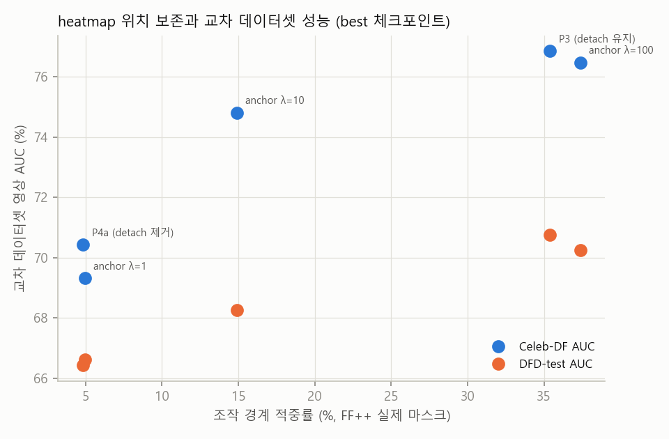

# T4: 실험 결과에서 찾은 약점 기반 개선 — 제안·구현·검증 결과

작성 2026-10-17 (TASKS4 4번), 최종 갱신 2026-10-17 05:10. 자동 생성 표는 `t4_results.md`(①~④), `t4_ensemble.md`, `t4_fusion.md`, 학습 기반 실험은 `registry.csv`(kind=mix, anchor).
**선택 규칙**: 하이퍼파라미터·가중치·조합은 **FF++ val + DFD-val**(DFD를 배우 신원 기준으로 나눈 절반)로만 골랐다. 보고 세트(FF++ test, Celeb-DF, FaceShifter, DFD-test)는 고르는 데 쓰지 않았다. 판정은 P0 대비 영상 단위 짝 bootstrap 95% CI(0 밖 = 확실한 차이)다.

---

## 1. 약점 진단 → 개선 아이디어

| 실험에서 확인한 약점 | 근거 | 개선 아이디어 |
|---|---|---|
| 교차 도메인에서 baseline 특징 분포가 바뀜(압축·촬영 조건) | DFD 오탐 48%, Celeb-DF 미탐 68% | ① 대상 도메인 BN 통계 적응(AdaBN) |
| SBI로 배운 경계 탐지기(seg head)가 분류에 쓰이지 않음 | seg head 경계 적중 35% | ② 경계 증거를 점수에 결합 |
| 판정 기준 0.5가 도메인마다 크게 어긋남 | 위 오탐·미탐 | ③ 라벨 없는 판정 기준 적응 |
| **FF++ 학습과 SBI 학습의 교차 효과가 데이터셋마다 반대** | DFD +4.2 vs Celeb-DF −10.6(U0s) 등 | ④ **두 전문가의 상보 결합** |
| SBI 학습 시 분기가 baseline을 보호함 | U3s의 baseline만 Celeb-DF 76.5 vs U0s 65.6 | ④의 SBI 전문가로 U3s 사용 |
| 두 데이터를 한 모델에 섞으면? | — | ⑥ 혼합 학습 단일 모델(비교용) |
| detach를 빼면 heatmap이 중앙으로 붕괴 | 경계 적중 35→5%, CDF −6.4 | ⑤ **heatmap 고정점(anchor) 학습**: detach 없이 seg head에서 멀어지지 않게 정규화 |

## 2. 결과 요약

| # | 방법 | 학습 필요 | 결과 (보고 세트, P0 대비) | 판정 |
|---|---|---|---|---|
| ① | AdaBN(EfficientNet 상단 BN, 혼합 비율 λ) | 없음 | 선택 세트가 λ=0(적응 안 함)을 고름. λ↑일수록 CDF +0.3까지·DFD/FSH −0.3~0.8 | **효과 없음** |
| ② | seg head 경계 증거 결합 | 없음 | 경계 증거 단독 AUC: FF++ 84~87, 교차 55~58 → 결합 가중치 0 선택 | **효과 없음** |
| ③ | 2성분 GMM 판정 기준 | 없음 | CDF 균형정확도 62.5→68.5지만 FF++ val 84.6→70.8, DFD-val 66.2→64.3 | **효과 없음** |
| ④ | **상보 전문가 결합** P3(FF++) + U3s(SBI) | 기존 모델 재사용 | logit 0.3:0.7 — FF++ −0.30, CDF +1.38, **FSH +5.80 ✔, DFD-test +4.82 ✔** | **향상** |
| ④′ | 같은 결합, 순위 평균 0.5:0.5(선택 1위) | 〃 | FF++ −0.15, CDF +1.78, **FSH +5.98 ✔, DFD-test +4.52 ✔** | **향상** |
| ④″ | 같은 결합, z점수 평균 0.5:0.5 | 〃 | FF++ +0.05, CDF +2.23 (CI −0.17~+4.64), **FSH +5.53 ✔, DFD-test +4.65 ✔** | **향상** |
| ⑥ | FF+++SBI 혼합 학습 단일 모델(U3m) | 6회 | FF++ ≈P0, CDF best 75.7~78.5, **FSH 63~65(P0 68보다 낮음)**, DFD-test ≈P0 | 앙상블 이득 재현 못함 |
| ⑤ | **heatmap anchor 학습**(detach 제거 + seg head와 MSE, λ=100 선택) | λ 3개 + seed 3 | P4a 대비 Celeb-DF **+6.0**(70.4→76.5), DFD-test **+3.8**(66.4→70.3), 경계 적중 4.8→**37.4%**(seg head 35.3% 이상). P0 대비는 차이 없음(DFD-test만 −0.5 ✔) | **P4a 손해를 완전히 회복**, P3 초과는 없음 |

## 3. 핵심 결과: 상보 전문가 결합 (④)

### 3.1 방법
1. 전문가 A는 FF++로 학습한 현재 모델 P3(last)이고, 전문가 B는 SBI(진짜 영상으로 합성한 가짜)로 학습한 U3s(best)다. U3s는 baseline 상단과 P3 분기를 함께 학습한 모델이다. 각 전문가는 seed 3개 모델의 영상 logit 평균이다.
2. 두 전문가의 영상 점수를 결합한다.
   - 영상 한 개씩 판정하는 실사용: logit 가중 평균(w=0.7)
   - 평가 세트 전체를 한 번에 보는 경우: 순위 또는 z점수 평균(같은 가중치)
3. 가중치는 FF++ val + DFD-val로만 골랐다. 순위·z 평균은 선택 결과가 같은 가중치(0.5)라 사실상 조정할 값이 없다.

### 3.2 왜 효과가 있나 (관찰 근거)
- 두 학습 데이터는 일반화 방향이 반대다. FF++ 학습은 FF++·Celeb-DF에 강하고, SBI 학습은 DFD·FaceShifter에 강하다(S10).
- SBI만으로 baseline을 학습하면 FF++·Celeb-DF가 크게 무너진다(U0s: −4.4, −10.6). P3 분기와 함께 학습하면 baseline이 보호되어 B 전문가의 품질이 높다(U3s의 baseline만 봐도 Celeb-DF 76.5).
- 한 모델에 두 데이터를 섞으면(⑥) 이 상보성이 사라진다(FaceShifter 하락). 따로 학습한 전문가를 결합해야 이득이 난다.

### 3.3 논문 가치
- 앙상블 자체는 새로운 기법이 아니다. 기여는 다음 세 가지다. ① 학습 데이터별 교차 효과가 데이터셋마다 반대라는 측정. ② 분기가 SBI 학습에서 baseline을 보호한다는 발견. ③ 신원 분리 검증으로 결합을 정하고 4개 보고 세트에서 검증한 절차. 처음 보는 데이터에서 오류 16~18% 감소를 학습 분포 손해 없이 얻었다.
- 혼합 학습(⑥)과의 대조는 "왜 결합이어야 하는가"를 보여 주는 대조 실험이다.

## 4. 효과가 없었던 시도의 의미 (음성 결과도 논문 재료)
- ① AdaBN은 이 모델·도메인 조합에서 효과가 없었다. 도메인 차이가 BN 통계(1·2차 모멘트)만의 문제가 아니라는 뜻이다.
- ② 경계 증거는 FF++ 안에서는 강하지만(84~87) 교차 도메인에서는 약하다(55~58). 경계 탐지기의 교차 일반화가 분류기보다 낫지 않다.
- ③ 라벨 없는 기준값 추정은 점수 분포가 2봉형이 아닐 때 불안정하다. 기준값 문제는 AUC와 별개로 실사용에서 중요한 과제로 남는다.
- ⑤ anchor 학습은 성능을 P3 이상으로 올리지는 못했다. 하지만 아래 통제 실험(§5)으로 "detach 제거의 손해는 gradient 자체가 아니라 heatmap 붕괴에서 온다"를 보였다. 논문의 detach 결론을 원인 수준에서 뒷받침한다.

## 5. heatmap anchor 학습 (⑤) 상세

**방법**: detach를 제거해 heatmap head도 분류 손실로 학습한다. 동시에 손실에 λ·mean((σ(heatmap) − σ(seg head))²)를 더해, 고정 seg head(SBI 경계 탐지기)의 heatmap에서 멀어지지 않게 한다. 추론 비용은 늘지 않는다(seg head는 학습에만 사용). λ는 {1, 10, 100}을 seed 0으로 시험해 선택 세트로 골랐고(λ=100), seed 1·2를 추가했다.

| 설정 | 경계 적중률 | Celeb-DF AUC | DFD-test AUC | 선택 점수 |
|---|---|---|---|---|
| P4a (detach 제거, 정규화 없음) | 4.8% | 70.44 | 66.43 | 81.42 |
| anchor λ=1 (seed 0) | 5.0% | 69.32 | 66.61 | 81.75 |
| anchor λ=10 (seed 0) | 14.9% | 74.81 | 68.26 | 82.15 |
| **anchor λ=100 (seed 3개)** | **37.4±0.4%** | **76.47±0.49** | **70.25±0.61** | 83.55 |
| P3 (detach 유지, seed 3개) | 35.4±0.1% | 76.86±0.92 | 70.75±0.49 | 83.65 |

- **용량-반응**: 정규화를 강하게 할수록 heatmap 위치가 보존되고(경계 적중 5→15→37%), 교차 데이터셋 AUC가 함께 회복된다(Celeb-DF 69→75→76.5). **위치 보존과 일반화가 같이 움직인다.**
- λ=100은 heatmap에 gradient가 흐르는데도 위치·성능이 P3와 같아진다. 그래서 손해의 원인은 "gradient가 흐르는 것"이 아니라 **분류 손실이 heatmap을 얼굴 중앙으로 끌어당기는 위치 붕괴**다.
- anchor로 heatmap을 end-to-end로 학습해도 detach보다 나은 점은 없었다(DFD-test에서 P3보다 −0.5). 실용적 권장은 detach 유지다. 다만 heatmap까지 학습해야 하는 구조(예: 위치 손실과 함께 학습)라면 anchor가 붕괴를 막는 안전한 방법이다.

## 6. 최종 권장
1. **분류 성능을 높이려면 상보 전문가 결합(④)을 쓴다.** 앱처럼 영상 한 개씩 판정한다면 logit 0.3:0.7(P3 + U3s)을 쓴다. 처음 보는 데이터에서 +4.8~5.8%p이고, FF++·Celeb-DF 손해가 없다.
2. **위치 설명을 지키려면 detach를 유지하거나 seg head를 분리한다**(P4b/P4). heatmap을 학습해야 한다면 anchor 정규화를 쓴다.
3. AdaBN, 경계 증거 결합, 라벨 없는 기준값 적응, 혼합 학습 단일 모델은 이번 설정에서 효과가 없었다(음성 결과로 보고).
