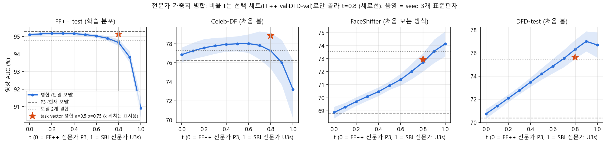

# TASKS5 결과: P3를 넘는 개선 — 데이터 전문가 가중치 병합

작성 2026-10-17. 대상 독자: 팀원·지도교수님(최종 발표·논문 준비). 자동 생성 표: `t5_final_tables.md`(`code/t5_final.py`), 병합 상세: `t5_merge.md`, 그림: `t5_fig_merge.png`, 방법 정의: `PROTOCOL.md` §18.
**규칙**: 모든 선택(병합 비율, 체크포인트, 기준값)은 FF++ val + DFD-val로만 했다. 보고 세트(FF++ test, Celeb-DF, FaceShifter, DFD-test)는 고르는 데 쓰지 않았다. ✔ = 영상 단위 짝 bootstrap 95% CI가 0 밖.

---

## 0. 결론 요약

1. **학습 없이 만든 단일 모델이 현재 모델 P3보다 처음 보는 데이터에서 확실히 좋다.**
   - 방법: FF++ 전문가(P3)와 SBI 전문가(U3s)의 **가중치를 섞는다**(모델 병합). 두 모델은 출발점(초기값)이 같아서 가능하다.
   - 추론 비용은 P3와 같다(모델 1개). 추가 학습도 없다.
   - task vector 병합, P3 대비 AUC: Celeb-DF **+2.60 ✔**, FaceShifter **+4.12 ✔**, DFD-test **+5.25 ✔**, FF++ test −0.16(차이 없음)
2. **정확도**: 선택 세트로 고른 기준값을 쓰면 Celeb-DF ACC가 오르고(+3.1~+5.6 ✔), 균형 정확도(bACC)는 Celeb-DF·DFD에서 확실히 오른다.
   - FF++ test ACC는 −0.7~−0.9로 차이 없음(불분명)이다.
   - DFD-test ACC는 내려간다. 이 세트는 영상의 85%가 가짜라 "전부 가짜"라고만 답해도 ACC가 85.1%다. P3의 ACC 75.0%부터가 이 단순 기준보다 낮다. 그래서 DFD에서는 ACC가 아니라 bACC로 판단해야 한다(§3.2).
3. **왜 되는가(대조 실험)**
   - 병합에서 FF++ 전문가를 빼고 SBI 학습량만 줄이면(WiSE-FT 방식) FF++·Celeb-DF·FaceShifter가 확실히 낮아진다(−1.2, −4.7, −2.5). 즉 이득은 **두 전문가의 지식을 합친 데서** 온다.
   - 두 데이터를 한 모델에 섞어 학습하면(혼합 학습) FaceShifter가 8.6 낮다. 따로 학습한 뒤 합쳐야 한다.
4. **AUC 외 가치도 유지된다**: 병합 모델의 heatmap 경계 적중은 35.1~35.3%로 P3(35.6%)와 같다. 위치 설명 능력을 잃지 않는다.
5. **효과 없거나 작았던 것**: 선택 세트 기준값 보정을 P3에 적용(오히려 하락), 좌우 반전 TTA(+0.0~0.5, 불분명), 전문가 증류(DFD +3.5 ✔지만 병합보다 약함, 학습 필요).

## 1. 시도한 방법과 판정

| # | 방법 | 학습 | 결과 | 판정 |
|---|---|---|---|---|
| M1 | **전문가 가중치 병합**(선형 / task vector) | 없음 | P3 대비 Celeb-DF·FaceShifter·DFD AUC 확실한 향상, FF++ 유지 | **향상** |
| M1′ | seed 수프(seed 3개 병합 모델의 가중치 평균) | 없음 | 깨지지 않고 단일 모델로 작동, 선택 점수 단일 모델 1위(85.74) | 향상(병합과 같은 수준) |
| M2 | 선택 세트 기준값 보정 | 없음 | P3·P0: Celeb-DF ACC 하락(도메인마다 기준값 이동 방향 반대). 병합 모델: 4세트 ACC·bACC 상승 | P3에는 효과 없음, 병합 모델과 함께 쓸 때 유효 |
| M3 | 상보 전문가 증류(교사 = 두 전문가 결합) | seed 3 | P3 대비 DFD +3.5 ✔, Celeb-DF +1.3·FaceShifter +1.8(불분명). 병합이 증류보다 FaceShifter +2.4 ✔·DFD +1.7 ✔ | 약한 향상(병합보다 못함) |
| M5 | 좌우 반전 TTA | 없음 | 모든 모델 +0.0~+0.5, CI 0 포함 | 작음 |
| (대조) | WiSE형(FF++ 전문가 없이 SBI 학습량만 줄임) | 없음 | 병합보다 FF++ −1.2·Celeb-DF −4.7·FaceShifter −2.5(✔) | 이득의 출처 확인용 |

## 2. 방법: 데이터 전문가 가중치 병합

### 2.1 아이디어
- 지난 실험(TASKS4)에서 FF++로 학습한 모델과 SBI로 학습한 모델이 **서로 다른 데이터셋에서 강하다**는 것을 확인했다. 두 모델의 출력을 섞는 결합(모델 2개 실행)이 DFD·FaceShifter에서 이득이었다.
- 이번에는 출력 대신 **가중치 자체를 섞어** 모델 하나로 만든다. 같은 seed의 P3와 U3s는 출발점(초기값 θ0)이 같다. θ0는 저자 baseline 상단, SBI 사전학습 분기, seed 규칙으로 정한 gating 초기값으로 이루어진다. 그래서 두 모델이 같은 손실 지형 근처에 있어, 섞어도 성능이 무너지지 않을 수 있다.

### 2.2 식
- 선형: θ(t) = (1 − t)·θ_P3 + t·θ_U3s
- task vector: θ = θ0 + a·(θ_P3 − θ0) + b·(θ_U3s − θ0)
- BatchNorm 통계(running mean/var)는 학습되는 가중치가 아니라 데이터 통계이므로 (a·A + b·B)/(a + b)로 섞는다(외삽하면 분산이 음수가 될 수 있다).
- P3는 baseline 상단을 학습하지 않았으므로 상단의 θ_P3 = θ0다. 따라서 상단은 SBI 학습량을 b배로 줄인 값이 되고, 분기는 두 전문가의 학습량을 a·b로 더한 값이 된다.

### 2.3 선택
- 격자: 쌍 3개((P3 last / P3 best / U3f) + U3s best) × (선형 t 11개 + task vector 16개) × seed 3개 = 243개 모델. 모두 선택 세트에서만 평가했다.
- 선택 1위: task vector `P3best + U3s, a = 0.5, b = 0.75`(85.581), 선형 1위: `P3best + U3s, t = 0.8`(85.576).
- 선택 세트 상위권 차이는 0.2 이하로, seed 간 표준편차(0.4~0.5)보다 작다. **결론은 어느 병합을 골라도 같다**(§3.1 표의 네 병합 모델 모두 FaceShifter·DFD에서 ✔).

## 3. 결과

### 3.1 AUC (P3 대비, seed 3개 평균)

| 모델 | 비용 | 선택 점수 | FF++ test | Celeb-DF | FaceShifter | DFD-test |
|---|---|---|---|---|---|---|
| P3 (현재 모델) | 1 | 84.00 | 95.29 | 76.24 | 68.82 | 70.40 |
| **task vector 병합** | 1 | 85.58 | 95.13 (−0.16) | **78.84 (+2.60 ✔)** | **72.94 (+4.12 ✔)** | **75.65 (+5.25 ✔)** |
| 선형 병합 t=0.8 | 1 | 85.58 | 94.66 (−0.63) | 77.27 (+1.03) | **72.72 (+3.90 ✔)** | **76.32 (+5.93 ✔)** |
| seed 수프(선형) | 1 | **85.74** | 94.67 (−0.61) | 78.07 (+1.83) | **72.24 (+3.42 ✔)** | **76.62 (+6.23 ✔)** |
| seed 수프(task vector) | 1 | 85.60 | 95.06 (−0.23) | **79.13 (+2.90 ✔)** | **72.84 (+4.02 ✔)** | **75.95 (+5.56 ✔)** |
| task vector 병합 + TTA | 2 | 85.80 | 95.25 (−0.03) | **79.13 (+2.89 ✔)** | **73.24 (+4.42 ✔)** | **75.78 (+5.38 ✔)** |
| (참고) 모델 2개 결합 | 2 | 85.24 | 94.80 (−0.49) | 77.29 (+1.05) | **73.59 (+4.77 ✔)** | **75.49 (+5.09 ✔)** |
| (참고) P0 | 1 | 83.94 | 95.22 | 76.15 | 68.01 | 70.78 |

- 그림: t를 0(P3)에서 1(U3s)로 옮기면 FaceShifter·DFD는 꾸준히 오른다. Celeb-DF는 t = 0.4~0.6에서 최고였다가 떨어지고, FF++는 t ≥ 0.8부터 떨어진다. 선택 세트가 고른 t = 0.8은 FF++를 크게 잃지 않으면서 교차 데이터셋 이득을 많이 얻는 지점이다.
- **단일 병합 모델이 모델 2개 결합과 같거나 낫다**(task vector 병합 − 결합: Celeb-DF +1.55 ✔, 나머지 차이 없음). 비용은 절반이다.

### 3.2 정확도 — 무엇을 봐야 하나

**ACC 하나로는 판단할 수 없는 이유**
- 보고 세트의 진짜:가짜 비율은 FF++ test 1:4, DFD-test 1:5.7, Celeb-DF 1:1.9, FaceShifter 1:1이다.
- "전부 가짜"라고만 답해도 ACC가 FF++ 80.0%, DFD 85.1%, Celeb-DF 65.6%다.
- 그래서 불균형 세트에서는 **bACC = (진짜 정답률 + 가짜 정답률)/2**를 함께 본다. 진짜 영상을 가짜로 모는 오탐률도 따로 본다.

**결과 (P3는 현재 앱 설정인 기준값 0.5)**

| 모델 (기준값) | FF++ ACC / bACC | Celeb-DF ACC / bACC | FaceShifter ACC | DFD-test ACC / bACC |
|---|---|---|---|---|
| P3 (0.5) | 90.6 / 84.5 | 51.7 / 61.7 | 65.2 | 75.0 / 62.8 |
| task vector 병합 (0.5) | 86.6 / 86.3 | 50.1 / 61.3 | 63.3 | 60.9 / **68.8 ✔** |
| task vector 병합 (보정 τ) | 88.2 / 86.1 | 52.1 / 62.7 | 65.0 | 64.5 / **68.9 ✔** |
| 선형 병합 (보정 τ) | 89.7 / 86.2 | **55.2 ✔ / 64.1 ✔** | 66.2 | 66.6 / **69.9 ✔** |
| seed 수프(선형) (보정 τ) | 89.7 / 85.0 | **57.3 ✔ / 65.1 ✔** | 65.7 | 68.2 / **68.7 ✔** |
| seed 수프(task vector) (보정 τ) | 89.9 / 86.7 | **54.8 ✔ / 64.4 ✔** | 66.4 | 67.2 / **68.4 ✔** |

(✔ = P3(0.5) 대비 확실한 향상. 전체 CI는 `t5_final_tables.md` §3.)

- **오른 것**
  - bACC: DFD-test에서 모든 병합 모델이 +5.6~+7.2 ✔다. Celeb-DF는 보정 기준값을 쓴 선형 병합·수프에서 +2.5~+3.4 ✔다.
  - ACC: Celeb-DF에서 +3.1~+5.6 ✔(보정 기준값 사용 시)다.
- **안 오른 것**
  - FF++ test ACC는 −0.7~−0.9로 불분명하다(task vector 병합 보정 기준값은 −2.3 ✔ 하락).
  - FaceShifter ACC는 −0.2~+1.2로 불분명하다.
  - DFD-test ACC는 하락한다. 병합 모델은 진짜 영상 오탐을 크게 줄이는 대신 가짜를 진짜로 보는 경우가 늘기 때문이다. 가짜가 85%인 세트에서는 이것이 ACC를 깎는다.
- **보정 기준값의 의미**: 같은 규칙(선택 세트 bACC 최대)을 P3에 적용하면 Celeb-DF ACC가 51.7 → 40.5로 떨어졌다. 병합 모델에서는 같은 규칙이 네 세트의 ACC·bACC를 모두 올렸다. 병합 모델의 점수 분포가 도메인 사이에서 덜 어긋난다는 뜻이다. 기준값 0.5에서 DFD 오탐률은 P3 54.6%, 병합 모델 12~20%다.

### 3.3 대조 실험: 이득은 어디서 오나

| 비교 (AUC) | 질문 | FF++ test | Celeb-DF | FaceShifter | DFD-test |
|---|---|---|---|---|---|
| task vector 병합 − WiSE 대조 | FF++ 전문가가 기여하나? | **+1.17 ✔** | **+4.69 ✔** | **+2.49 ✔** | +0.06 |
| task vector 병합 − 혼합 학습 | 섞어 학습 vs 따로 학습 후 병합 | −0.01 | **+1.51 ✔** | **+8.60 ✔** | **+3.58 ✔** |
| task vector 병합 − 모델 2개 결합 | 단일 모델 vs 앙상블 | +0.33 | **+1.55 ✔** | −0.65 | +0.16 |
| task vector 병합 − SBI 전문가 단독 | 병합 vs U3s | **+4.21 ✔** | **+5.63 ✔** | −1.20 | −1.06 |

- **WiSE 대조**(θ0 + b·(θ_U3s − θ0), FF++ 전문가 없음)는 "SBI로 학습한 만큼을 조금 되돌리기만 해도 좋아지는가"를 본다. 선택 세트 점수는 85.44로 비슷하다. 그러나 보고 세트에서 FF++·Celeb-DF·FaceShifter가 확실히 낮다. 따라서 이득의 상당 부분은 **FF++ 전문가의 지식**에서 온다. 기존 WiSE-FT와 구별되는 지점이다.
- DFD 이득(+0.06, 차이 없음)은 SBI 전문가 쪽에서 온다.

### 3.4 증류 (M3)
- **방법**: 학생은 U3 구조(θ0에서 시작)다. FF++ 8장 + SBI 8장 배치로 20 epoch 학습한다. 손실은 정답 CE에 교사(같은 seed P3×0.3 + U3s×0.7 결합) logit에 대한 KD(β = 1, T = 2, 미리 고정)를 더한 것이다. 체크포인트는 선택 세트로 골랐다(last, 84.51).
- **결과(P3 대비 AUC)**: FF++ −0.42, Celeb-DF +1.34, FaceShifter +1.75(불분명), **DFD-test +3.54 ✔**
- **병합과 비교**: 병합이 FaceShifter **+2.37 ✔**, DFD **+1.71 ✔**, Celeb-DF +1.26으로 더 낫다.
- **의미**
  - 혼합 학습(정답만 사용)보다는 낫다(FaceShifter 70.6 vs 64.3). 교사 신호가 상보성의 일부를 옮긴다.
  - 그러나 1회 50~80분의 학습을 들이고도 **학습 없는 병합보다 못하다.**
  - 이 구조에서는 "따로 학습 → 가중치 병합"이 가장 효율적이다.

### 3.5 AUC 외 지표 (상세: `t5_beyond_auc.md` §7)
- 위치 설명: 경계 적중 35.1~35.3%, 경계 AUROC 70.7(P3 35.6%·70.5). 병합해도 유지된다.
- 오탐률(진짜를 가짜로, 기준값 0.5): 병합 모델은 모든 세트에서 크게 줄인다. 대신 미탐이 늘어난다(`t5_beyond_tables.md` 표 B).

  | 세트 | P3 | task vector 병합 | 수프(lin) |
  |---|---|---|---|
  | FF++ test | 25.7% | 14.0% | 12.1% |
  | Celeb-DF | 6.6% | 2.6% | 2.8% |
  | FaceShifter | 25.5% | 14.5% | 12.1% |
  | DFD-test | 54.6% | 19.9% | 12.1% |

- seed 안정성(AUC 표준편차 평균): P3 0.12, task vector 병합 0.56, 출력 결합 0.94, U3s 1.44. 병합은 SBI 전문가의 불안정성을 크게 줄인다. 다만 P3만큼 안정적이지는 않다.

## 4. 논문 가치 (정직한 평가)

- **새롭지 않은 것**
  - 모델 병합 자체는 기존 기법이다: model soup(Wortsman et al., ICML 2022), WiSE-FT(Wortsman et al., CVPR 2022), task arithmetic(Ilharco et al., ICLR 2023), TIES-merging(Yadav et al., NeurIPS 2023).
  - 딥페이크 탐지에서도 생성기별 전문가를 병합하는 R²M(ECCV 2026, arXiv 2509.24367)이 있다.
- **이 연구에서 새로운 것**
  1. **학습 데이터 종류가 다른 전문가**(실제 위조 영상 FF++ vs 진짜 영상만으로 합성한 SBI)의 병합이다. 두 전문가는 교차 데이터셋 효과가 반대이고, 병합 단일 모델이 양쪽 장점을 가져간다.
  2. 고정 멀티모달 탐지기(M2F2-Det) + 국소 분기 구조에서 단일 병합 모델이 **모델 2개 결합 이상**이다. 혼합 학습·증류보다 낫고, 위치 설명 능력도 유지한다.
  3. WiSE 대조로 **FF++ 전문가 task vector의 기여를 분리**했다(Celeb-DF +4.7 ✔).
  4. 공유 사전학습 덕분에 **seed 간 수프**도 깨지지 않는다.
  5. 앞선 실험의 **통제 비교 절차**(신원 분리 선택 세트, 보고 세트 분리, 짝 bootstrap)로 검증했다.
- 학부 학술대회(KCC·KSC)라면 "통제 ablation + 원인 규명 + 학습 없는 개선"으로 충분한 기여다. 국제 학회라면 R²M 등과 같은 벤치마크(DF40 등)에서 비교해야 한다.

## 5. 한계
- **DFD-test**: 선택 세트 DFD-val과 같은 데이터셋(배우만 다름)이라 완전히 처음 보는 도메인은 아니다. **Celeb-DF와 FaceShifter가 진짜 처음 보는 세트**이고, 둘 다 병합에서 확실히 향상했다.
- **FF++ test**: AUC는 유지(−0.16)이지만 ACC는 약간 낮다(보정 기준값에서도 −0.7~−2.3).
- **Celeb-DF 미탐**: 미탐률은 여전히 60%대다. 모든 모델이 Celeb-DF 가짜를 진짜 쪽으로 점수 매긴다.
- **범위**: 한 구조(M2F2-Det + P3 분기)와 c40 화질에서만 확인했다. 전문가는 2개만 썼다.
- **선택 세트 상위권**: 차이가 작아(0.2 이하) 어떤 병합을 "최고"라 부를지는 seed 변동 범위 안이다.

## 6. 실사용 권장
- **앱 모델 교체 후보**: task vector 병합(또는 seed 수프) 단일 모델이다. 추론 비용은 현재 P3와 같다.
- **기준값**: 선택 세트 보정 기준값을 쓴다(task vector 병합 τ = 0.35·0.515·0.485(seed별), 수프(task vector) τ = 0.405). 0.5를 그대로 쓰면 진짜 쪽 판정이 많아진다.
- 적용 전에 앱의 실제 입력(압축률·얼굴 정렬)으로 한 번 더 확인해야 한다. 이번 결과는 c40 화질 기준이다.
